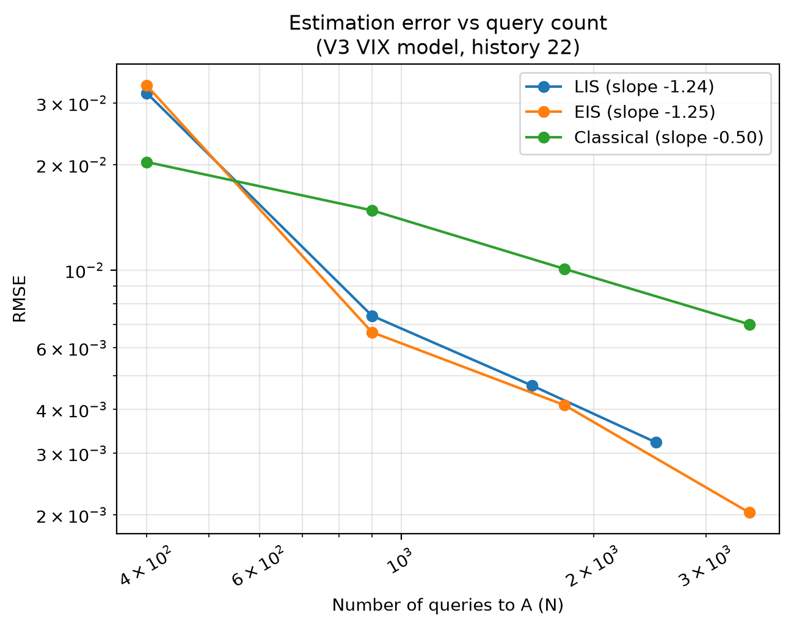

# Quantum Amplitude Estimation (QAE)

## What this does, in one paragraph

We want to know: **"Given the market's volatility over the last two days, what is the chance that volatility stays high (VIX ≥ 30) on at least 3 of the next 6 trading days?"** The usual way to estimate a probability like this is to simulate many possible futures and count how often the event happens (classical Monte Carlo). This code does the same job with a **quantum algorithm** and shows it reaches a more accurate answer for the same amount of work: about **2–3× less error** in our tests.

## Key ideas in plain language

| Term | What it means here |
| --- | --- |
| **VIX** | A market "fear index". Higher VIX means more volatile markets. We sort each day into low (< 20), moderate (20–30) or high (≥ 30). |
| **Risk event** | "VIX is high on at least 3 of the next 6 days." |
| **p** | The true probability of that event. Member 1's model gives it exactly, so we can check our answers against it. |
| **Classical Monte Carlo** | Simulate N random futures and count how many contain the event. The error shrinks slowly: 4× more samples only halve the error. |
| **Quantum amplitude estimation** | A quantum method that can, in principle, halve the error with only 2× more work, a "quadratic speed-up". |
| **MLAE** | Maximum Likelihood Amplitude Estimation: the practical version of amplitude estimation used here. It needs only short circuits plus some classical post-processing. |
| **Query (N)** | One use of the circuit that simulates the market. This is how we measure "amount of work", so classical and quantum are compared fairly. |
| **RMSE** | Root-mean-square error: the typical size of the estimation error. Lower is better. |

## How it works (4 steps)

1. **Simulate every possible future at once.** A quantum circuit (built by Member 2) holds all 729 possible 6-day VIX paths in superposition, each weighted by how likely it is.
2. **Mark the risky futures.** A small "counter" circuit counts how many of the 6 days have high VIX, and switches on a **flag qubit** when the count is 3 or more. If you measured the flag now, it would read 1 with probability exactly p.
3. **Amplify.** The **Grover operator** rotates the quantum state in a precise, predictable way, so that after m rotations the flag reads 1 with probability sin²((2m+1)θ), where sin²θ = p. Each rotation makes the flag far more sensitive to small changes in p.
4. **Estimate.** We run the circuit with several different numbers of rotations, count how often the flag reads 1, and find the value of p that best explains those counts. This is the "maximum likelihood" step.

## Results at a glance



At **N = 3,500 queries**, quantum error vs classical error for each starting history (the last two days' VIX levels):

| Last two days | Event probability p | Quantum error | Classical error | Quantum is… |
| --- | --- | --- | --- | --- |
| low, low (00) | 0.2% | 0.00022 | 0.00071 | 3.3× more accurate |
| low, moderate (01) | 4.2% | 0.00101 | 0.00341 | 3.4× more accurate |
| moderate, moderate (11) | 7.1% | 0.00190 | 0.00417 | 2.2× more accurate |
| moderate, high (12) | 64.0% | 0.00341 | 0.00798 | 2.3× more accurate |
| high, high (22) | 78.2% | 0.00203 | 0.00700 | 3.4× more accurate |

"Quantum" here is MLAE with the exponential schedule. Each value is averaged over 300 repeated runs.

**What this shows:**
- Quantum estimation is **more accurate than classical at the same cost** for every history tested.
- Its error falls faster as you spend more queries: roughly like 1/N^0.9, against 1/N^0.5 for classical. That's close to the theoretical quantum speed-up.
- **The caveat:** with a very small budget (400 queries) the quantum method isn't reliably better, and for history 22 it was worse. It needs enough rotations to pin the answer down.

## Quick start

**1. Install** (Python 3.12+, run from the repository root):
```bash
python -m venv .venv
source .venv/bin/activate          # Windows: .venv\Scripts\activate
pip install qiskit scipy pandas matplotlib ipykernel
```

**2. Estimate one probability** (takes about 2 minutes):
```python
from qae import *

A = build_A_v3_marked(8)                        # history "high, high" (see index table below)
print(Statevector(A).probabilities([19])[1])    # exact probability: 0.78237...

Q = grover_op(A, 19)
p_hat, N = mlae(A, Q, eis(2), shots=100, flag_qubit=19)
print(p_hat, N)                                 # quantum estimate ≈ 0.78, using N = 900 queries
```

**History index:** `index = 3 × (day before yesterday) + (yesterday)`, with 0 = low, 1 = moderate, 2 = high.

| History | 00 | 01 | 02 | 10 | 11 | 12 | 20 | 21 | 22 |
| --- | --- | --- | --- | --- | --- | --- | --- | --- | --- |
| Index | 0 | 1 | 2 | 3 | 4 | 5 | 6 | 7 | 8 |

**3. Reproduce the full results** (about 40 minutes):
```python
from qae import *
np.random.seed(40552026)
LABELS = ["00", "01", "02", "10", "11", "12", "20", "21", "22"]

for lab in ["00", "01", "11", "12", "22"]:
    i = LABELS.index(lab)
    A = build_A_v3_marked(i)
    res = run_experiment(A, grover_op(A, 19), REF_V3[i], flag_qubit=19, K_max=4)
    summarise(res, f"v3_{lab}")                         # prints the table, saves a CSV
    plot_results(res, f"Error vs queries (history {lab})", f"rmse_vs_N_v3_{lab}.png")
```
Results are saved in `output/`.

## Files

| File | What's in it |
| --- | --- |
| `qae.py` | All the code: the event oracle, Grover operator, MLAE and experiments |
| `qae_demo.ipynb` | Step-by-step notebook: checks, experiments, plots |
| `member2/sc4055_2.py` | Member 2's circuit that simulates the VIX futures |
| `model/nine_state_model_specification.json` | Member 1's fitted VIX model and the exact probabilities |
| `output/` | Result tables (`.csv`) and plots (`.png`) |

## How we know it's correct

| Check | Result |
| --- | --- |
| Circuit's event probability vs Member 1's exact value, all 9 histories | Identical to 8 decimal places |
| Grover rotation, history 22, m = 0–4 | Matches the formula sin²((2m+1)θ) exactly |
| Classical Monte Carlo error vs theory √(p(1−p)/N) | Matches for every history |
| A second, independently built circuit | Gave identical probabilities and identical estimates |

---

## Technical details

### Qubit layout (20 qubits)

| Qubits | Role |
| --- | --- |
| 0–3 | Memory register (Member 2's model state) |
| 4 + 2t, 5 + 2t | Day t's VIX category, t = 0…5. Qubit 5 + 2t = 1 means VIX ≥ 30 |
| 16–18 | Counter (3 bits) |
| 19 | Flag: 1 when the counter is ≥ 3 |

### Main functions

| Function | Description |
| --- | --- |
| `build_A_v3_marked(index)` | Member 2's circuit + the ≥3-of-6 counter oracle. The flag is on qubit 19 |
| `REF_V3` | Exact event probabilities for the 9 histories |
| `grover_op(A, flag_qubit)` | Grover operator Q = A′ S₀ A′† S_χ |
| `reflect_zero(n)` | The reflection S₀ used inside Q |
| `mlae(A, Q, ms, shots, flag_qubit)` | Returns (estimate p̂, queries used N) |
| `lis(K)`, `eis(K)` | Rotation schedules: m = 0, 1, …, K (linear) or m = 0, 1, 2, 4, …, 2^(K−1) (exponential) |
| `run_experiment(A, Q, p_true, ...)` | Error vs queries for quantum (both schedules) and classical |
| `summarise(...)`, `plot_results(...)` | Print/save the results table and plot |
| `resources(qc)` | Qubits, CX gates and depth after compiling to hardware gates |
| `count_hits(...)`, `count_hits_fast(...)` | Simulated measurements. The fast version computes each circuit's exact probability once, then samples from it (statistically identical for a noiseless simulator) |

### Query cost

One run of a circuit with m Grover rotations uses the market circuit 2m + 1 times, so N = Σ shots × (2m + 1). Classical Monte Carlo is given the same N.

### Scaling (fitted log-log slopes, excluding the smallest budget)

| Method | Slope | Paper (Chen et al.) |
| --- | --- | --- |
| Classical | −0.49 to −0.52 | −0.5 |
| MLAE, linear schedule | −0.72 to −0.81 (−1.27 for history 12) | −0.75 |
| MLAE, exponential schedule | −0.87 to −1.00 | −0.98 |

### Circuit cost (compiled to {CX, RZ, SX, X})

| Circuit | Qubits | CX gates | Depth |
| --- | --- | --- | --- |
| Market circuit + oracle (A′) | 20 | 440 | 1,389 |
| One Grover step (Q) | 20 | 2,272 | 3,164 |
| Deepest circuit used (8 Grover steps) | 20 | ≈ 18,600 | — |

### Earlier testbed: two-state model

Before V3, the pipeline was built on a simpler synthetic model (Normal / Stressed market, 3 days). For its "3-day loss ≤ −5%" event, quantum error at N = 6,800 was 2.8× lower than classical. Use `build_A_markov_loss()` with `flag_qubit=3`.

### Notes for developers

- Pass `flag_qubit` explicitly: 19 for V3, 3 for the two-state circuits.
- If you call `mlae` directly with a different circuit, call `clear_cache()` first. `run_experiment` does this automatically.
- Accuracy doesn't depend on how the market circuit is built (it depends only on p); circuit cost does.

## Limitations

- **Simulation only.** No real quantum hardware was used. The deepest circuit has about 18,600 two-qubit gates, far more than today's noisy hardware can run reliably.
- **Small budgets:** with fewer than about 900 queries, the quantum method can be less accurate than classical.
- **It estimates the model's probability, not the market's.** Better estimation doesn't make Member 1's VIX model a better forecaster, and for this small model, an exact classical calculation takes milliseconds.

## Reference

J. Chen et al., "Quantum-Enhanced Inference of Conditional Future Probabilities with Reduced Memory Cost," arXiv:2610.10756 (2026).
