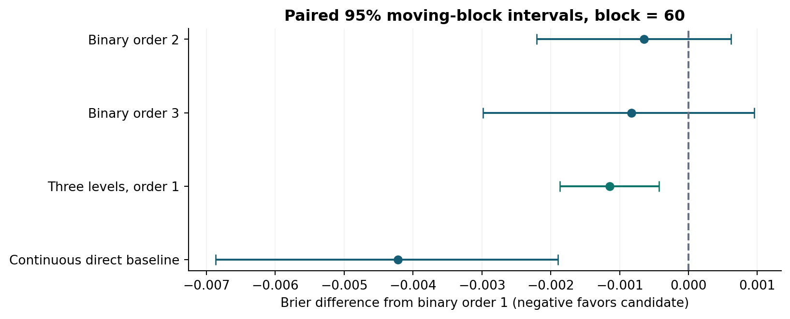
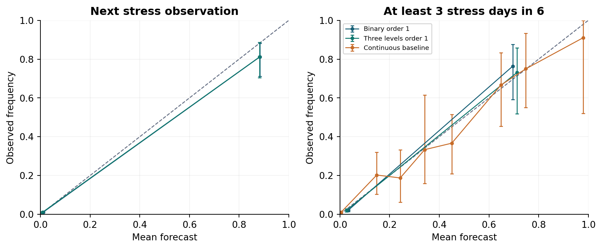
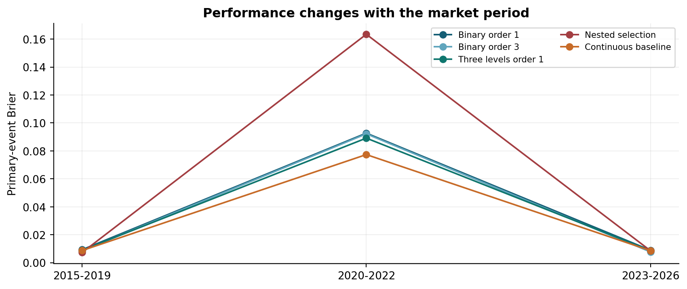
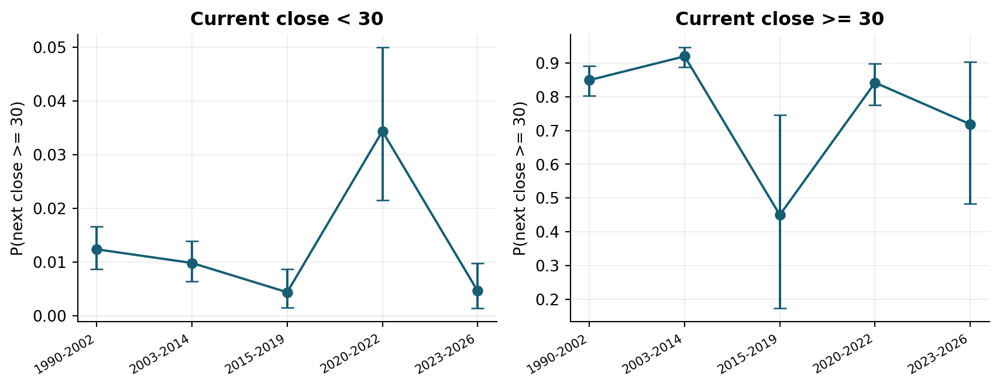
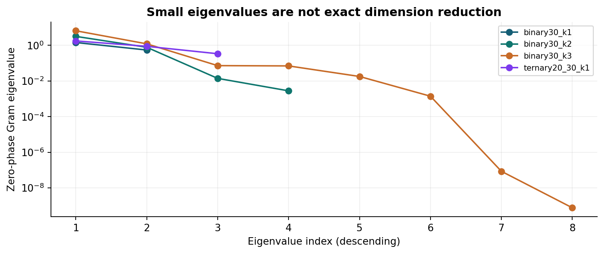

# SC4055 V3.0 Phase 2

## VIX market-stress
predictive models

Data-driven stochastic modeling and causal-state validation

SC4055 V3.0 - Phase 2 | Research version 1.0 | 25 October 2026

Decision: retain a small, data-calibrated generator, but do not claim a unique best financial model or a quantum dimension advantage. The evidence supports strong persistence, modest additional history effects and material information loss from discretization.

| Evidence | Result |
| --- | --- |
| Verified official data | 9,301 daily closes; 1990-01-02 to 2026-10-23; original snapshot hash reproduced. |
| Primary event | At least three VIX closes >=30 in the next six trading observations. |
| History dependence | First order is much better than IID. Orders 2/3 improve one-step log loss; six-step event gains versus first order remain inconclusive. |
| Financial alternative | Three-level order 1 improves pooled event prediction; continuous log-VIX event regression is stronger still. |
| Conditional freeze | Binary order 1 under a 0.001 Brier engineering tie tolerance; binary order 2 if that tolerance is tightened to zero. |
| Quantum status | Selected two-state model is coherently representable, with no physical memory-qubit reduction. Binary order 3 cannot be exact in one qubit under a fixed autonomous instrument. |

All historical results are retrospective. Nested rolling origins prevent future-data fitting inside the evaluation algorithm; they do not erase the earlier inspection of 2020-2026. No post-cutoff confirmatory observations are available. The supplied V1/V2 records remain unchanged.

## 1. Data and integrity

The official Cboe daily-history CSV was downloaded again on 25 October 2026. Its 474,094 bytes have SHA-256 f94378e505b286168d8dd466cc3a30bb12606ba34084d7ac53de953c75ba2ecd, exactly matching the prior investigation. Direct download followed Cboe's redirect to cdn-api.cboe.com. [S1]

| Check | Observed result |
| --- | --- |
| Rows and range | 9,301; 1990-01-02 through 2026-10-23 |
| Missing values / duplicate dates | Zero in all supplied fields / zero |
| Ordering / weekends | Already ascending; no Saturday or Sunday records |
| Long calendar gaps | 7 days ending 2001-09-17; 5 days ending 2007-01-03 and 2012-10-31 |
| Cleaning | Strict date parsing; reject missing, duplicate or nonpositive closes; sort; cap cutoff; CLOSE only |
| Trading convention | Each step is the next source trading observation. No forward fill or calendar-day resampling. |

A source gap is not automatically an erroneous missing record. No independent full exchange-holiday reconciliation was performed, so the manifest flags gaps without inventing observations. Source dates are interpreted as trading-session labels, not UTC timestamps.

The contemporaneous CSV is a current-vintage history. We do not have a vintage database with the exact values available on each historical forecast date. Historical revisions and real-time publication availability cannot be independently excluded. Consequently these are retrospective current-vintage forecasts, not a certified point-in-time trading backtest.

Raw bytes are retained privately for the analysis but omitted from the deliverable ZIP because an affirmative redistribution license was not established. The official download script, response manifest, full-file hash and canonical date/CLOSE-prefix hash are supplied. A changed historical prefix stops reproduction rather than silently altering the frozen experiment.

## 2. Financial meaning and discretization

VIX is an options-implied, annualized measure of expected S&P 500 volatility over approximately 30 calendar days. Persistent elevated closes describe sustained implied market stress, potentially relevant to exposure monitoring and hedging decisions. VIX does not directly measure realized investment losses, the direction of returns, or borrower default probabilities. [S1-S2]

The event threshold 30, six-observation horizon and three-observation count are analyst choices. They describe recurring elevated implied volatility over roughly a trading week, allowing interruptions. They are not regulatory cutoffs, utility-optimal decisions, or a financial black-swan definition.

| Observation definition | Edges | Full-sample symbol counts |
| --- | --- | --- |
| binary20 | 20.00 | 5868/3433 |
| binary25 | 25.00 | 7697/1604 |
| binary30 | 30.00 | 8564/737 |
| binary35 | 35.00 | 8948/353 |
| ternary20_30 | 20.00, 30.00 | 5868/2696/737 |
| Training q80 | 24.15 | 7437/1864 |
| Training tertiles | 15.20, 20.74 | 3093/3102/3106 |

Fixed thresholds and training-derived quantiles are all investigated. Quantiles are recalculated only from each fold's training observations; the full-sample values above are descriptive and never feed the historical selector. Class balance alone does not establish predictive or financial value.

Discretization discards within-bin level, severity and daily movements. Squared level reconstruction error using training-bin means is exported as a descriptive information-loss proxy, not a theorem about predictive sufficiency. The continuous direct-event baseline provides a more relevant empirical check of discarded forecasting information.

## 3. Evaluation protocol and leakage controls

The primary estimand was fixed before these new comparisons: stress means CLOSE>=30; f=1 when at least three of the next six observations are stress observations. Binary30 and the <20 / 20-<30 / >=30 model predict precisely this same event. Other thresholds and quantiles predict their own high-category events. Their raw loss values are never ranked against one another to choose a financial threshold.

| Layer | Construction |
| --- | --- |
| Outer historical evaluation | 2015-2026, calendar years in temporal order; 2026 ends on 23 October. Expanding training ends before 1 January of each scored year. |
| Inner order/alphabet selection | For outer year y, score three preceding years y-3 through y-1, each from a fit ending before its own January 1. |
| Eligibility | All history contexts must have >=25 training continuations in every inner fold. This is a declared engineering support rule. |
| Selection rule | Pooled primary-event Brier; candidates within 0.001 of the eligible minimum are tied; prefer fewer states, then binary. |
| Final future-use choice | Use 2023-2025 inner scores; refit the chosen generator through 2026-10-23. Its final-fit parameters are not used to rescore old data. |

One-step targets belong to the scored year. A context can end on the preceding year's last observation because it is then already known. Event windows must finish within the scored year: the final five potential origins are excluded from event scoring, while their next-step forecasts remain. No training label crosses a training cutoff.

There are 3,003 one-step targets and 2,943 eligible six-step windows for each common-target model. The previously inspected static 2020-2026 results are reproduced separately, not reused as fresh confirmation. A genuinely new holdout starts after the data cutoff; observations from 26 October onward are unavailable in this snapshot.

## 4. Mathematical model and estimation

Let X_t be the observed category at completed session t. An order-k model has state S_t=(X_{t-k+1},...,X_t), indexed oldest to newest in base m. For k=0 there is one empty state. Histories are initially candidate predictive states, with m^k configurations; minimization is a separate exact calculation.

lambda(s,x) = (m*s + x) mod m^k
p(x|s) = (n_sx + alpha)/(n_s + m*alpha)
T^(x)[s,j] = p(x|s) * 1[j=lambda(s,x)]
T = sum_x T^(x),     sum_j T[s,j] = 1

The main prior is symmetric Dirichlet with alpha=1/2 per symbol. For binary outcomes this is Beta(1/2,1/2). The smoothed probabilities are exact rational numbers derived from integer counts; floating exports preserve double precision. Alpha=0.1,1,2 are sensitivity cases, not extra tuning options.

Each context table supplies n_s, each continuation count, emission estimates, exact rational values, nominal 95% Beta marginal intervals, empirical context weights, stationary occupancy and a count>=25 support flag. A nominal posterior assumes a homogeneous Markov transition law. It does not establish stationarity or independent financial stress episodes.

All emissions are strictly positive. Every k-symbol word therefore reaches its matching context from any starting history in k steps. The fitted history chain is irreducible and has self loops, so a unique stationary distribution exists. Positive smoothed reachability does not imply observed support: unobserved histories remain flagged.

The index-level model is autonomous and time homogeneous only as a specified approximation. There are no borrower covariates, latent-credit states, realized returns, portfolio values or loss amounts. An observed history fixes the finite-order state exactly; no HMM belief-state assumption is used.

## 5. Exact predictive states and complexity

Two states are equivalent precisely when every finite future word has the same conditional probability. Cylinder probabilities determine the full future law. In a positive unifilar model, equivalence requires equal next-symbol emissions and equivalent successors for every symbol. Starting with emission signatures and repeatedly refining successor blocks therefore computes the coarsest exact future-equivalent partition.

Every signature uses rational probabilities, with no numerical distance threshold or clustering tolerance. For the binary orders 1-3, all 2,4,8 contexts remain distinct. The three-level order-3 fit has redundant contexts: 27 history configurations reduce to 24 causal states of the fitted process. Its exact quotient inherits probabilities; pooled counts are not resmoothed.

| Model | History states | Exact D_c | Probability-rank evidence |
| --- | --- | --- | --- |
| Binary IID | 1 | 1 | Exact rank 1 |
| Binary orders 1 / 2 / 3 | 2 / 4 / 8 | 2 / 4 / 8 | Exact ranks 2 / 4 / 8 |
| Three-level order 1 / 2 | 3 / 9 | 3 / 9 | Exact ranks 3 / 9 |
| Three-level order 3 | 27 | 24 | Rank >=22 from modular witness; rank deficiency not certified |

For each original history model, form F[s,w]=P(w|s) over length-k words. A nonzero determinant modulo the prime 1,000,000,007 is an exact certificate that the corresponding rational square matrix is full rank. Because a positive k-symbol prefix synchronizes to its suffix state, F is an invertible row-scaled Hankel submatrix in the full-rank cases. Machine-readable certificates include the prime, determinant and indexing.

A deficient modular rank is only a lower bound, not proof of exact rank deficiency. A fixed quantum instrument in dimension D produces probabilities through a D^2-dimensional operator space, so D>=ceil(sqrt(rank)). No finite-data estimate of D_c is asserted for the true VIX process.

## 6. Out-of-sample predictive comparisons

| Model | Stress log loss | Stress Brier | Event Brier |
| --- | --- | --- | --- |
| Binary IID | 0.216822 | 0.051505 | 0.056848 |
| Binary order 1 | 0.082559 | 0.018279 | 0.030279 |
| Binary order 2 | 0.077808 | 0.017773 | 0.029635 |
| Binary order 3 | 0.074520 | 0.017451 | 0.029448 |
| Three levels, order 1 | 0.070648 | 0.017999 | 0.029131 |
| Three levels, order 2 | 0.068647 | 0.017464 | 0.028651 |
| Three levels, order 3 | 0.067017 | 0.017296 | 0.028712 |
| Continuous direct event | - | - | 0.026059 |
| Current-state event frequency | - | - | 0.030723 |
| Nested selected policy | 0.158240 | 0.039250 | 0.047255 |

Scores pool 2015-2026 forecasts from annual expanding fits. Lower is better. Stress log loss and stress Brier refer to the same next-day >=30 event even for the three-category models. Full categorical scores are exported separately and cannot be compared across different alphabets. The observed six-step event rate is 0.057764.

IID misses persistence. Second/third binary orders lower one-step losses. Three levels retain useful information about whether a below-30 close is below 20 or already elevated. Higher three-level orders have sparse or absent contexts and are not eligible under the declared support rule.

The continuous baseline is a fixed ridge logistic regression for the primary event, using current log(VIX) and its most recent change. Features are standardized on training origins only; event labels finish before the training cutoff; ridge penalty is fixed at 1. It is an event-specific discriminative forecast, not a self-contained generator of joint future paths. It is the strongest pooled event forecaster among the tested baselines, not a globally optimal financial model.

## 7. The six-step benefit of more history

| Compared with binary order 1 | Brier difference | 95% interval |
| --- | --- | --- |
| Binary order 2 | -0.000645 | [-0.002202, 0.000617] |
| Binary order 3 | -0.000832 | [-0.002984, 0.000956] |
| Three-level order 1 | -0.001148 | [-0.001869, -0.000430] |
| Continuous direct | -0.004220 | [-0.006869, -0.001896] |

Binary order 2 and order 3 gains for the primary event are smaller than 0.001 Brier and their block-60 intervals include zero. The data support a one-step history benefit, but do not establish a practically meaningful six-step benefit from extra binary history. This does not prove no benefit exists.

Intervals use 2,000 paired circular moving-block resamples within each outer year. Model boundaries are never crossed by a block. Block lengths 10,20,60,120 and the three historical period groups are exported. They estimate conditional score uncertainty for these fitted forecasts; they do not include a new full selection/refitting cycle in each score resample or correct all exploratory multiplicity.

## 8. Calibration and reliability

Reliability plots compare average forecasts with empirical frequencies in fixed probability deciles. Error bars are block-60 retrospective intervals; only bins with at least 20 observations appear in the figure. The CSV retains every nonempty bin, sample count and number of usable bootstrap repetitions.

The aggregate forecast rate for binary order 1 is 0.068462 against an observed event rate of 0.057764. Three-level order 1 predicts 0.062876 on average; the continuous baseline predicts 0.054365. These means alone cannot diagnose conditional calibration; bins and changing regimes must also be inspected.

A common state produces repeated probabilities, so effective information is smaller than the number of daily windows. Event windows overlap and stress episodes persist. The intervals are accordingly wider than naive independent-binomial error bars. For rare bins, even block resampling can provide little new information; absence of a visible discrepancy is not proof of calibration.

No post-hoc isotonic or Platt recalibration is fitted on the outer evaluation set. Such a change would be a new model requiring its own training-only protocol and fresh evaluation.

## 9. Regime sensitivity

The primary event is highly nonstationary across these periods. Regime comparisons use forecasts already generated from each year's preceding data, not parameters refitted inside the scored period. The period labels are broad calendar groupings, not estimated latent market regimes.

The 2015-2019 interval has few severe-stress observations. A validation objective dominated by that calm experience can prefer almost-zero event forecasts, while 2020-2022 rewards the ability to retain persistence. Sparse recent stress also makes conditional transition estimates unstable. The results should not be generalized to an invariant financial law.

Long expanding windows stabilize estimates but can blend distinct market regimes and index methodologies. Short windows adapt faster but leave very few stressed-state continuations. This study reports that tradeoff rather than selecting a favorable window after inspecting test scores.

## 10. Selection failure and conditional choice

The recorded nested selector chooses binary IID in 2015-2020, three-level order 1 in 2021-2025, and binary order 1 in 2026. IID can win the quiet inner years because the main event scarcely occurs. Its poor response to the subsequent stress period is retained as an important failure of this selection policy.

The selected-policy event Brier is 0.047255, compared with 0.030279 for a fixed first-order binary family. Thus nested validation prevents future-data fitting, but does not by itself make a selection rule financially robust. No repaired selector is retroactively substituted.

| Allowed Brier tie | Selected final model | Inner Brier |
| --- | --- | --- |
| 0.00000 | binary30, k=2 | 0.009020 |
| 0.00025 | binary30, k=2 | 0.009020 |
| 0.00050 | ternary20_30, k=1 | 0.009307 |
| 0.00100 | binary30, k=1 | 0.009755 |
| 0.00200 | binary30, k=1 | 0.009755 |

At the recorded 0.001 tolerance, final validation selects binary order 1. With zero tolerance, the supported binary order-2 model wins. At 0.0005, three-level order 1 is chosen. These tolerances are engineering preferences, not economic-loss equivalences. No unique winner follows without a stated tradeoff.

The pooled retrospective best supported finite-state family is three-level order 1; the continuous direct baseline is stronger for the event. The frozen binary first-order model is therefore a conditional small-generator reference, with a disclosed sacrifice in pooled predictive performance. A broader financial forecasting objective should keep the continuous baseline and obtain future validation before adopting the generator.

## 11. Frozen principal: explicit numerical model

Observation X_t=1 iff VIX CLOSE>=30. States s0 and s1 are the most recent observed symbol, with lambda(s,x)=x. The final engineering-reference fit uses all 9,301 observations through 2026-10-23; it has 9,300 transitions. It is a future-use refit, not the parameters used to generate all historical scores.

| State | n | Next 0 | Next 1 | P(next 1) | Nominal 95% interval |
| --- | --- | --- | --- | --- | --- |
| s0 | 8563 | 8470 | 93 | 0.010918 | [0.008827, 0.013225] |
| s1 | 737 | 93 | 644 | 0.873306 | [0.848388, 0.896309] |

T^(0) = [[0.989082204577, 0],
         [0.126693766938, 0]]

T^(1) = [[0, 0.010917795423],
         [0, 0.873306233062]]

T = [[0.989082204577, 0.010917795423],
     [0.126693766938, 0.873306233062]]

Rows are current states, columns are next states. A below-30 session has fitted next-day stress probability 1.09%; after a >=30 session it is 87.33%. The marked transitions are stress observations, not default or realized loss events. The stationary occupancy is (0.920662,0.079338); empirical context occupancy is also supplied separately.

| Current state | P(at least 3 stress observations in next 6) |
| --- | --- |
| s0: last CLOSE<30 | 0.032920987586 |
| s1: last CLOSE>=30 | 0.675445043786 |

These are exact-to-numerical-precision probabilities under the fitted model. They are not real-world probabilities known without parameter and model uncertainty. Full-precision matrices, rational emissions, indexing, provenance, uncertainty and validation status are in frozen_principal.json.

## 12. More history and the fallback

The binary order-2 alternative has four states 00,01,10,11. In this indexing 01 ends in stress and 10 ends below threshold: changing the order changes the interpretation. Its lambda rule drops the oldest symbol and appends the output.

| History | n | Next stress count | P(next stress) | Primary event probability |
| --- | --- | --- | --- | --- |
| 00 | 8469 | 74 | 0.008796 | 0.023112 |
| 01 | 93 | 64 | 0.686170 | 0.628139 |
| 10 | 93 | 19 | 0.207447 | 0.155748 |
| 11 | 644 | 580 | 0.900000 | 0.776953 |

The large difference between 00 and 10 suggests an elevated chance of re-entry immediately after a stress observation, while 01 versus 11 distinguishes newly entered from already persistent stress. This is a description of fitted conditional frequencies, not a causal economic mechanism.

| From / to | 00 | 01 | 10 | 11 |
| --- | --- | --- | --- | --- |
| 00 | 0.991204 | 0.008796 | 0.000000 | 0.000000 |
| 01 | 0.000000 | 0.000000 | 0.313830 | 0.686170 |
| 10 | 0.792553 | 0.207447 | 0.000000 | 0.000000 |
| 11 | 0.000000 | 0.000000 | 0.100000 | 0.900000 |

All four contexts have at least 93 full-sample continuations. Binary order 3 has eight distinct predictive states but its least-supported full-sample context has only 19 continuations; its inner folds fail the count>=25 gate. Fourth-order and variable-length searches are deferred because the primary-event evidence and support do not justify expanding this phase's search.

The simpler fallback is the one-state IID binary generator in frozen_fallback.json. It discards the current-state distinction entirely and is predictively much weaker: pooled event Brier 0.056848. Its role is a minimal stochastic control when recurrent memory must be eliminated, not a financially equivalent substitute.

## 13. Financial alternative: three levels

Use X=0 for VIX<20, X=1 for 20<=VIX<30, X=2 for VIX>=30. The order-1 state is the current category and lambda(s,x)=x. The primary event counts only category 2, so its target is identical to binary30.

| Current / next | 0: <20 | 1: 20-<30 | 2: >=30 |
| --- | --- | --- | --- |
| 0 | 0.956377268 | 0.043367130 | 0.000255602 |
| 1 | 0.094717331 | 0.870991659 | 0.034291010 |
| 2 | 0.000677048 | 0.126607989 | 0.872714963 |

Each emission-labelled matrix T^(x) has only column x nonzero, with that column equal to the corresponding probability column above. Full numerical arrays and separate CSV matrices are supplied. This convention fixes all three matrices without ambiguity.

| Current category | Primary-event probability |
| --- | --- |
| 0 | 0.006829997077 |
| 1 | 0.087740281779 |
| 2 | 0.690976374229 |

The below-30 binary category merges ordinary and moderately elevated volatility. Splitting it improves the pooled event Brier by -0.001148. The block-60 paired interval excludes zero, but the inference is exploratory and some period/block sensitivity is wide. This is stronger financial evidence than simply increasing the binary history-state count.

Three-level order 2 has the lowest pooled Brier among the fixed finite-order candidate families, but some of its nine histories are unobserved in training. Smoothing makes its defined process valid without making those probabilities empirically reliable. It is therefore an unsupported challenger, not the recommended frozen principal.

The first-order three-level alternative uses a conventional three-dimensional quantum memory, padded to two physical qubits. One-qubit realization with different phases is not ruled out by probability rank three, but no such instrument is constructed or promised here. Its financial merits are evaluated independently of that question.

## 14. Transition estimates change over time

The subperiod fits are descriptive diagnostics with the same Beta(1/2,1/2) smoothing. They do not alter the historical forecast parameters. Re-entry from below 30 is estimated near 0.0044 in 2015-2019 and near 0.0343 in 2020-2022. Those are materially different environments for the same binary state definition.

The stressed-state persistence estimate ranges from 0.4500 in 2015-2019 to 0.9199 in 2003-2014. The quiet 2015-2019 estimate uses only nine stressed-state continuations, and 2023-2026 uses 15; the corresponding intervals are broad. This is evidence of weak support as well as possible drift, so a precise structural-change story is not inferred.

Cboe's 2003 change replaced the original OEX-based index framework; the original series is now distinguished as VXO. SPX weekly options entered the VIX calculation on 6 October 2014, and that weekly-options change was not backdated. Combining long histories therefore mixes index methodology as well as economic periods. [S1,S3]

A viable next financial study would explicitly compare rolling windows, covariates and changing thresholds with training-only selection and new outcomes. This phase stops at documenting instability; it does not present current-vintage subperiod estimates as fixed investment decision probabilities.

## 15. Parameter and event uncertainty

| Method | Block | s0 interval | s1 interval |
| --- | --- | --- | --- |
| Dirichlet_posterior | 0 | [0.026151, 0.040180] | [0.625192, 0.727937] |
| context_pair_block_refit | 20 | [0.024118, 0.040425] | [0.598756, 0.744232] |
| context_pair_block_refit | 60 | [0.022596, 0.044576] | [0.556175, 0.759216] |
| context_pair_block_refit | 120 | [0.020296, 0.046477] | [0.539404, 0.766377] |

These intervals concern the primary six-step event. The nominal posterior propagates 500 independent Dirichlet draws per context through exact DP. Its interpretation is conditional on the homogeneous finite-order likelihood and chosen prior.

The dependent refit resamples the original context/next-symbol pairs in circular blocks of 20,60,120 observations, refits transition probabilities and re-evaluates the event. Original contexts are preserved; block boundaries never fabricate new symbol transitions. Five hundred replicates per block are saved, including emission and event draws.

The stressed-state interval widens notably at longer blocks. A daily transition count does not equal an equally large number of independent stress episodes. Parameter-refit intervals are separate from the score-comparison bootstrap; neither automatically covers discretization bias, omitted covariates, future regime shifts, threshold uncertainty or researcher selection.

Changing alpha across 0.1,0.5,1,2 has small effects on the supported binary models compared with their model-order and regime differences. Exact fold-level sensitivity tables are included. Unobserved three-level histories are much more prior-sensitive in interpretation, even when aggregate scores move little.

## 16. Exact event module

For a known current predictive state s, the general target is p_s=Pr(f(X_{t+1},...,X_{t+L})=1 | S_t=s). The current observation belongs to the conditioning history and is never counted as a future observation.

| Event | Predicate and conditioning |
| --- | --- |
| Primary persistent stress | sum I[X>=high] >=3 over L=6 |
| At least one stress observation | max I[X>=high] =1 over L=6 |
| Sustained run | At least three consecutive high symbols somewhere in L=6 |
| First high-state entry | At least one future high symbol, restricted to histories whose current symbol is not high |
| Severe stress entry | Binary CLOSE>=35, first entry within six observations when current CLOSE<35 |
| Category upgrade | Three-level path reaches any category greater than the current category within six observations |

Enumeration multiplies emission probabilities along every output word and sums words satisfying an independent predicate. Dynamic programming instead propagates the product of predictive state and a finite event automaton. For a count threshold K, the counter saturates at K; for a run event it increments on high symbols, resets on other symbols, and retains an absorbing success state.

V_0(s,c) = 1[c=K]
V_(l+1)(s,c) = sum_x p(x|s) V_l(lambda(s,x), a(c,x))
p_s = V_L(s,0)

The two algorithms agree across all exported principal state/event pairs; the maximum discrepancy is 1.33e-15. Unit tests additionally cover impossible events, always-true events, runs, binary/ternary alphabets and several horizons. These checks establish mathematical consistency of the module, not the empirical truth of the fitted probabilities.

Sparse count DP costs O(L D m K) time and O(D K) working memory. At these small dimensions it is an efficient exact classical method. Enumeration is O(m^L L) and is used only as an independent small-horizon reference. No quantum speedup over DP is claimed.

## 17. Exploratory quantum memory geometry

After k common outputs, all finite-order histories synchronize. Therefore a conventional zero-phase Gram matrix is G_ij=sum_w sqrt(P(w|i)P(w|j)) over all k-symbol words. It is analytically positive semidefinite with unit diagonal and satisfies the recurrent overlap equation. Decimal arithmetic at 90 digits and a Cholesky factorization are numerical diagnostics, not exact symbolic rank proofs. [S4-S5]

| Model | C_mu bits | C_q bits | Physical memory upper bound |
| --- | --- | --- | --- |
| Binary order 1 | 0.399841 | 0.335281 | 1 qubit |
| Binary order 2 | 0.524129 | 0.353797 | 2 qubits |
| Binary order 3 | 0.641788 | 0.377318 | 3 qubits |
| Three levels order 1 | 1.227379 | 1.012572 | 2 qubits |

C_mu is the stationary predictive-state Shannon entropy and C_q the constructed quantum ensemble's von Neumann entropy. Both depend on the fitted stationary ensemble. An entropy reduction is not a reduction in the number of qubits allocated to one circuit. Small nonzero eigenvalues are retained; no tolerance-based truncation is labeled exact.

## 18. Quantum readiness and boundaries

| Candidate | D_c | Rank lower bound | What follows |
| --- | --- | --- | --- |
| Binary order 1 | 2 | 2 | D_q>=2; conventional D_q=2; exact dimension optimal, no dimensional saving. |
| Binary order 2 | 4 | 4 | D_q>=2; conventional dimension 4; one-qubit realization unresolved. |
| Binary order 3 | 8 | 8 | D_q>=3; any fixed one-qubit instrument is excluded. |
| Three-level order 1 | 3 | 3 | D_q>=2; conventional dimension 3; phase-assisted qubit possibility unresolved. |
| Three-level order 3 | 24 | >=22 | D_q>=5; sparse fit and unresolved zero-phase factorization; do not advance. |

For successful zero-phase factorizations, columns of S are memory states and Y_x[:,i]=sqrt(p(x|i))*S[:,lambda(i,x)]. Operators K_x=Y_x S^-1 on a full-rank span satisfy recurrence and completeness. The package computes them at high precision, then checks recurrence and sum K_x^dagger K_x=I in floating point. This is an instrument diagnostic, not a compiled quantum algorithm.

Binary orders 0-3 and three-level orders 0-2 pass the 1e-9 numerical instrument checks. The three-level order-3 history Gram is singular from exact redundant contexts; its 24-state quotient also lacks a validated full-rank Cholesky factorization here. This unresolved computation is retained. A mathematically valid smaller-span realization might exist; it is not inferred from a tiny eigenvalue.

For the selected binary order 1, a count-oracle design needs 1 memory qubit, 6 retained output qubits, 3 count-work qubits and 1 flag: 11 qubits before compilation choices. Binary order 2 would use 12, binary order 3 uses 13, and three-level order 1 uses 18 with two output qubits per observation. These are register estimates, not compiled gate counts.

A later coherent preparation must retain final memory and outputs, initialize the observed state reversibly, implement a clean event predicate, validate path probabilities and include all registers in the zero reflection and inverse. MRQPE here means Memory-reduced Quantum Probability Estimation. No new MLAE/QAE pipeline, phase search or lossy-instrument training is performed in this phase. [S4]

## 19. Final research decisions

Which discretization?

For the common >=30 persistence event, three levels retain demonstrably useful below-threshold information. Binary>=30 remains a defensible small reference, not the uniquely optimal discretization. Other thresholds define different scenarios.

How much history?

At least one observation is useful. Binary orders 2/3 improve one-step scores; their extra value for the six-step primary event is not established. Order 2 is supported; order 3 is sparse.

How are causal states built?

Form base-m histories, fit emissions, then refine exact rational emission/successor signatures to whole-future equivalence. State claims apply to the fitted finite process only.

What are the transitions?

The frozen binary matrix is [[0.9890822046,0.0109177954],[0.1266937669,0.8733062331]]. Full and emission-labelled arrays are exported for all principal fits and exact quotients.

Does it outperform baselines?

First order clearly improves on IID retrospectively. It does not outperform the continuous direct-event regression. The adaptive selection policy performs poorly after quiet validation years.

Are parameters stable?

No invariant law is established. Transition estimates and forecast scores vary across periods; sparse high-stress samples limit diagnosis.

Which future events?

Count, hitting, consecutive-run, conditional first-entry, severe>=35 and higher-category events have explicit predicates and independent exact calculations.

Coherent simulation suitable?

Yes for the selected finite unifilar generator; its zero-phase instrument passes recurrence/completeness checks. Full circuit compilation remains a later phase.

Exact quantum reduction?

Absent for the selected two-state model; one-qubit realization is excluded for binary order 3. Other phase-assisted reductions remain unresolved; no advantage is manufactured.

What should be frozen?

Conditionally freeze binary order 1 under the recorded tolerance; retain three-level order 1 as financial alternative and binary order 2 for stricter precision. IID is a weaker no-memory fallback. Obtain future validation before claiming a financial winner.

## 20. Reproducibility and verification

The pipeline is self-contained apart from standard scientific Python dependencies, optional local report fonts and the official downloadable data. No old implementation code is imported. Prior aggregate score CSVs are included only for independent comparison. The previous static-split order-1/2/3 next-step and event scores reproduce to floating-point precision; maximum log-loss difference is 6.94e-17.

The new pipeline changes the evaluation unit to annual expanding fits with nested selection, compares multiple alphabets and thresholds, exports exact predictive quotients, adds dependent parameter uncertainty, and freezes an explicit future-use specification. IID counts include all training observations; the earlier IID exploration omitted the first observation. That small convention difference is documented rather than hidden.

| Deliverable area | Location |
| --- | --- |
| Protocol and provenance | configs/protocol.json; data/manifests/ |
| Raw derived forecasts / metrics | results/outer_forecasts.csv.gz; outer_summary.csv; fold_scores.csv |
| Statistical evidence | paired_block_intervals.csv; calibration_intervals.csv; regime_scores.csv; event_uncertainty.csv; parameter draws |
| Explicit models and exact states | models/*/model.json; T_*.csv; context_counts.csv; minimal_predictive_model.json |
| Exact events / quantum readiness | src/modeling.py; structure.py; exact_event_checks.csv; structural_diagnostics.json |
| Execution and preservation | validation/test_results.txt; forecast_ledger_integrity.json; source_preservation.json |
| Independent regeneration | scripts/run_research.py; supplementary_analysis.py; make_figures.py; build_report.py |

The final tests check indexing, normalization, future-data invariance of fitting and quantiles, exact state equivalence beyond one-step emissions, independent DP/enumeration, recurrent instrument path probabilities, and forecast chronology. A forecast-ledger readback caught a truncated initial compressed export; the final exporter verifies decompression byte for byte. The verified delivered ledger contains 99,099 derived rows.

All 17 supplied/source files in the preservation catalog, including the V2 ZIP, retain their original hashes. There is no claim to certify an unavailable independent V1 repository. Original quantum benchmarks were inspected as prior records and were not rerun for this classical phase. The official rubric requires a final quantum implementation; this phase alone is not the complete group-project submission. [S6]

## 21. Sources, limitations and next gate

S1. Cboe, VIX Index Historical Data and official daily CSV. Retrieved 2026-10-25. https://www.cboe.com/tradable_products/vix/vix_historical_data ; https://cdn.cboe.com/api/global/us_indices/daily_prices/VIX_History.csv

S2. Cboe, VIX Options Product Specification and volatility overview. Expected 30-day volatility from SPX options. https://www.cboe.com/tradable_products/vix/vix_options/specifications

S3. Andersen, Bondarenko and Gonzalez-Perez, VIX Maturity Interpolation, 5 August 2024, original research hosted by Cboe. 2014 weekly-options change and non-backdating. https://cdn.cboe.com/resources/education/research_publications/VIXInterpolationWhitepaper.pdf

S4. Chen et al., Quantum-Enhanced Inference of Conditional Future Probabilities with Reduced Memory Cost, arXiv:2610.10756v1, supplied full PDF. Recurrent inference, Algorithm 1, Appendices A-D and F. https://arxiv.org/abs/2610.10756

S5. Supplied SC4055 Independent Model Research Report (25 October 2026) and recovered research package: earlier exploratory VIX snapshot, mathematical cautions and aggregate scores. New claims in this report are independently calculated and scoped to these fitted models.

S6. Supplied official SC4055 requirements screenshots/transcription, project context, accepted proposal, task allocation, phase-one model/architecture/experiment documents, and V2 final report extracted read-only from the supplied archive. Cropped rubric wording is not reconstructed.

What remains unresolved

A single nonstationary index, inspected historical outcomes, sparse independent stress episodes and a current-vintage file limit financial inference. Block intervals cannot repair structural model error. The discretization and event thresholds have no demonstrated optimal economic utility. Score differences across distinct financial targets are not comparable evidence of threshold quality.

Next gate

Keep the recorded specifications and collect post-cutoff outcomes without tuning on them. Before any production quantum estimation, choose explicitly between the binary engineering reference, the three-level financial alternative and the stricter order-2 option; document the tolerance. Then implement and validate only the corresponding coherent recurrence, initialization, reversible event oracle and full preparation inverse. Compare estimator error around model truth separately from financial predictive error. Efficient exact classical DP remains visible throughout.
