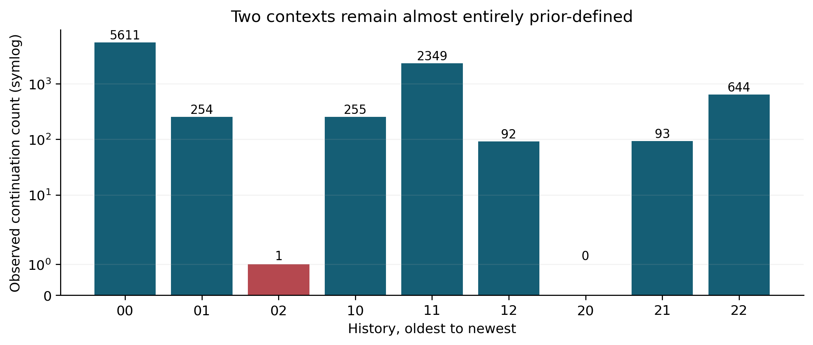
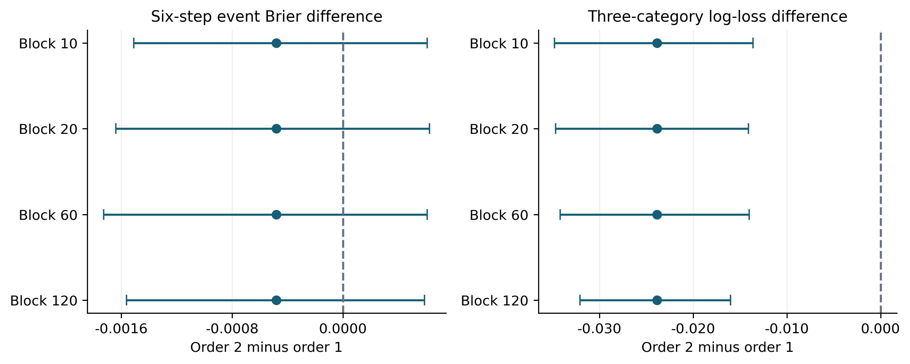
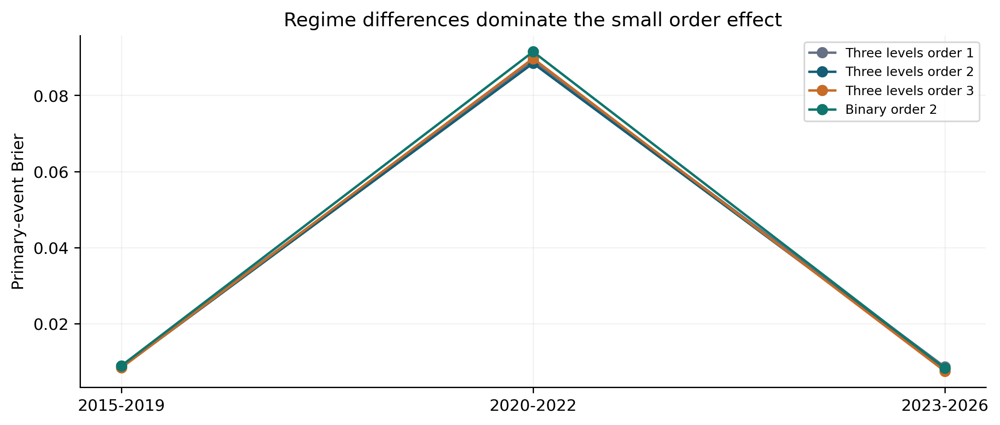
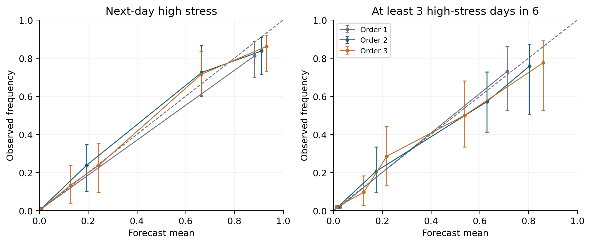
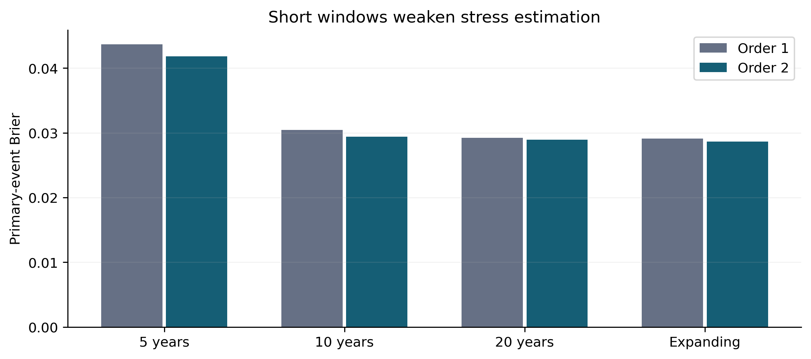
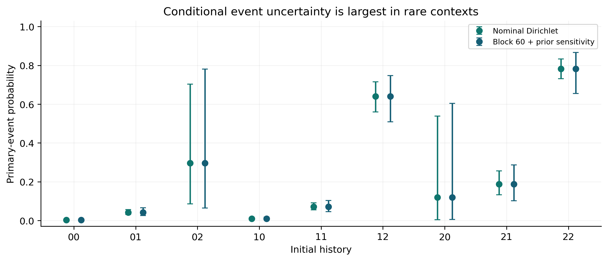
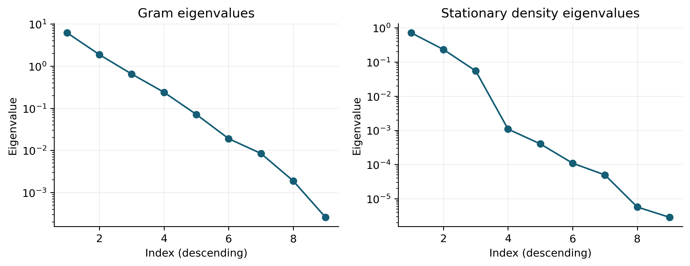
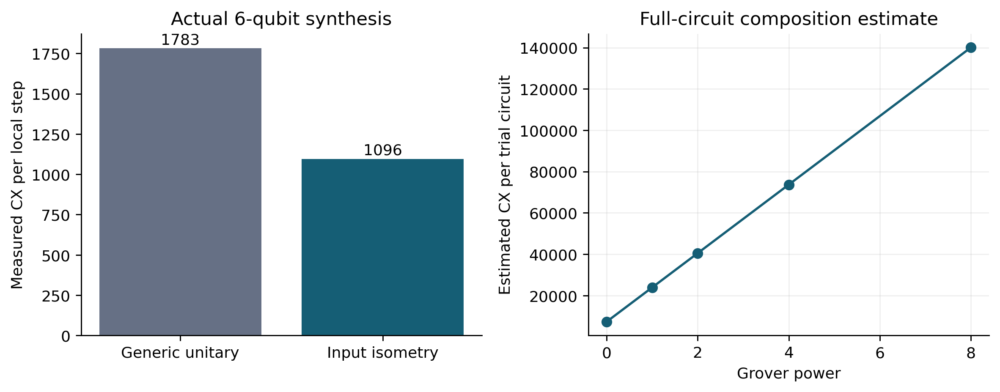

# SC4055 V3 Phase 3

## Focused validation of a
nine-state VIX model

SC4055 V3.0 - Phase 3 | Data, predictive memory and implementation readiness

25 October 2026 | Version 1.0 | Full QAE implementation is outside this phase

Decision: CONDITIONAL GO as a real-data-calibrated research demonstrator. The nine-state process is mathematically explicit and has a valid recurrent quantum implementation, but it is not established as a superior six-step financial forecaster. Two contexts remain unsupported, and exact phase-based dimensional compression is ruled out in the specified pure-state architecture.

| Evidence | Verified result |
| --- | --- |
| Financial comparison | Order-2 event Brier 0.028651 versus order-1 0.029131. Difference -0.000480, about 1.65%; block-60 interval includes zero. |
| Sparse histories | 02 has one continuation; 20 has none. Their reference prior weights are 60% and 100%. |
| Classical structure | Nine distinct, reachable causal states of the defined fitted process; exact probability rank nine. |
| Quantum structure | Validated zero-phase dimension nine. A new exact all-phase certificate excludes dimensions <=8 and <=4 within the pure unifilar one-Kraus-per-symbol class. |
| Resource pilot | A 6-qubit local step compiles to 1,096 CX using input-isometry synthesis. One/two-step 20-qubit Aer tests pass. |
| Implementation boundary | Six-step A, event oracle, Grover powers and production MLAE remain next-phase work. Full-circuit costs below are component estimates. |

This continuation prioritizes the requested three-level order-2 candidate. It does not reopen the full model search, rewrite Phase 2's recommendation, or reclassify inspected historical observations as new confirmation. Earlier project records remain preserved.

## 1. Provenance and focused protocol

The unchanged official Cboe snapshot contains 9,301 daily closes, 1990-01-02 through 2026-10-23. Its full-file SHA-256 is f94378e505b286168d8dd466cc3a30bb12606ba34084d7ac53de953c75ba2ecd. The canonical date/CLOSE prefix hash is checked before any Phase-3 fit. Missing closes and duplicate dates are absent in the supplied snapshot. [S1]

VIX is an options-implied measure of approximately 30-day expected S&P 500 volatility. These labels represent persistent implied market stress, not realized portfolio losses, borrower defaults or directional return predictions. Thresholds 20/30 and the primary event remain the earlier analyst-defined specification, with no quantum-rank-driven threshold tuning. [S1]

| Element | Fixed construction |
| --- | --- |
| Observation | 0: CLOSE<20; 1: 20<=CLOSE<30; 2: CLOSE>=30. |
| State and prior | Last two categories; Dirichlet(0.5,0.5,0.5) per history. |
| Primary event | At least three future category-2 observations in six future trading observations. |
| Historical forecasts | Annual expanding fits ending before each outer year 2015-2026; observed contexts update, parameters remain frozen within the year. |
| Direct comparison | Three-level orders 1,2,3; binary orders 1,2. Same >=30 event and identical forecast origins. |
| Uncertainty and sensitivity | Paired annual moving blocks 10/20/60/120; 3,000 replicates; three fixed market periods; fixed windows/priors/pooling alternatives. |

All 3,003 next-step forecasts and 2,943 six-step origins per model reconstruct the preserved Phase-2 forecasts within 1e-12. Six-step labels end within their scored year. Historical data through the cutoff were already inspected, so the new contrasts are retrospective and exploratory. No historical-vintage feed is available; current-vintage revisions cannot be independently excluded.

## 2. What each history means

State ab means the previous observation was a and the latest completed observation is b. Integer indexing is 3a+b, in the sequence 00,01,02,10,11,12,20,21,22. Financial descriptions below identify observed category movements; they do not assign an economic cause.

| History | Meaning | n | Empirical occupancy | Stationary occupancy |
| --- | --- | --- | --- | --- |
| 00 | low -> low | 5611 | 0.603398 | 0.602685 |
| 01 | low -> moderate | 254 | 0.027315 | 0.027436 |
| 02 | low -> high (abrupt stress entry) | 1 | 0.000108 | 0.000268 |
| 10 | moderate -> low (cooling) | 255 | 0.027422 | 0.027544 |
| 11 | moderate -> moderate | 2349 | 0.252608 | 0.252403 |
| 12 | moderate -> high (stress entry) | 92 | 0.009894 | 0.010040 |
| 20 | high -> low (abrupt cooling) | 0 | 0.000000 | 0.000161 |
| 21 | high -> moderate (recent stress exit) | 93 | 0.010001 | 0.010148 |
| 22 | high -> high (persistent stress) | 644 | 0.069255 | 0.069315 |

The final model fit uses all available observations through the cutoff, giving 9,299 history/continuation triples. These full-fit counts define the future-use research reference. They were not used to generate forecasts in earlier outer years.

States 00,11,22 account for most historical occupancy. States 12 and 21 distinguish stress entry from recent stress exit; their full-fit continuation counts are 92 and 93. Abrupt jumps 02 and 20 have only one and zero continuations, respectively. All nine are retained, while those two are explicitly prior dominated.

Phase 2's requirement of at least 25 continuations in every context still fails. Conditional research use does not mean that this financial support gate has been passed. Model-defined reachability from smoothing and empirical observation frequency are different facts.

## 3. Emissions, counts and uncertainty

| History | Counts (0,1,2) | p(0|s) | p(1|s) | p(2|s) |
| --- | --- | --- | --- | --- |
| 00 | (5426,184,1) | 0.966860 | 0.032873 | 0.000267 |
| 01 | (101,151,2) | 0.397260 | 0.592955 | 0.009785 |
| 02 | (0,1,0) | 0.200000 | 0.600000 | 0.200000 |
| 10 | (185,70,0) | 0.723197 | 0.274854 | 0.001949 |
| 11 | (154,2124,71) | 0.065731 | 0.903850 | 0.030419 |
| 12 | (0,28,64) | 0.005348 | 0.304813 | 0.689840 |
| 20 | (0,0,0) | 0.333333 | 0.333333 | 0.333333 |
| 21 | (0,74,19) | 0.005291 | 0.788360 | 0.206349 |
| 22 | (0,64,580) | 0.000775 | 0.099923 | 0.899303 |

For output x and history s, p(x|s)=(n_sx+0.5)/(n_s+1.5). Counts are observed frequencies. The smoothed estimates are the exact transition probabilities of the specified reference process. Nominal posterior intervals describe parameter uncertainty conditional on the chosen homogeneous Markov likelihood and prior; they are not market guarantees.

| History | 95% interval: output 0 | 95% interval: output 1 | 95% interval: output 2 |
| --- | --- | --- | --- |
| 00 | [0.962022, 0.971383] | [0.028368, 0.037693] | [0.000019, 0.000833] |
| 01 | [0.338192, 0.457852] | [0.532196, 0.652335] | [0.001637, 0.024969] |
| 02 | [0.000278, 0.753358] | [0.085499, 0.983263] | [0.000278, 0.753358] |
| 10 | [0.666964, 0.776133] | [0.222052, 0.330981] | [0.000002, 0.009774] |
| 11 | [0.056070, 0.076091] | [0.891614, 0.915436] | [0.023864, 0.037730] |
| 12 | [0.000005, 0.026719] | [0.216231, 0.401303] | [0.593005, 0.778982] |
| 20 | [0.000625, 0.950625] | [0.000625, 0.950625] | [0.000625, 0.950625] |
| 21 | [0.000005, 0.026438] | [0.700997, 0.864174] | [0.131405, 0.293053] |
| 22 | [0.000001, 0.003888] | [0.078008, 0.124183] | [0.874965, 0.921299] |

The unobserved 20 row is exactly (1/3,1/3,1/3), entirely from the prior; each nominal marginal interval is approximately [0.000625,0.950625]. For 02, the sole continuation is category 1, yielding (0.2,0.6,0.2). Smoothing is necessary to complete this reference process, but does not validate either row financially. Complete machine-readable counts and intervals accompany the report.

## 4. Sparse-state impact on six-step inference

Only one of 2,943 scored outer origins is currently in a rare state: 02 on 2018-02-05. No scored origin is 20. The generated future can still enter these states, so counting current origins alone would understate their relevance.

Under the final reference model, the empirically weighted chance of using either sparse row during the next six transitions is 0.191%. This is a model-conditional sensitivity diagnostic, not an estimated real-world guarantee that abrupt jumps are negligible.

| Initial history | Reference event | Robust lower | Robust upper |
| --- | --- | --- | --- |
| 00 | 0.002027 | 0.001731 | 0.002783 |
| 02 | 0.295562 | 0.000000 | 1.000000 |
| 12 | 0.639929 | 0.638993 | 0.645913 |
| 20 | 0.119505 | 0.000222 | 1.000000 |
| 22 | 0.782374 | 0.781911 | 0.784282 |

The robust envelope allows each rare row to choose any output distribution at every visit. It therefore covers every fixed replacement of those rows and additional adaptive choices. It is a conservative sensitivity bound, not a confidence interval. Common-state predictions move much less than the rare initial-state predictions; neither rare starting state supports a precise financial forecast.

## 5. Is the second category useful?

| Metric: order 2 minus order 1 | Difference | 95% block-60 interval |
| --- | --- | --- |
| Six-step event Brier | -0.000480 | [-0.001727, 0.000609] |
| Next-day high-stress log loss | -0.002002 | [-0.005722, 0.001322] |
| Full three-category log loss | -0.023869 | [-0.034177, -0.014023] |

The primary-event gain is about 1.65% relative to order 1. All tested block lengths have event-Brier intervals spanning zero. The point improvement is below the earlier 0.001 absolute Brier engineering tie tolerance and below the additional 5% relative reporting yardstick. Neither yardstick is an economic utility standard.

Full three-category next-step log loss improves by about 0.023869 nats, with negative paired intervals across the tested block lengths. The binary high-stress next-step contrast is less certain. Thus extra memory helps predict category movements more clearly than it improves this particular six-step stress-count event.

Intervals preserve pairing and resample circular blocks within outer years, never across fitted-model boundaries. They condition on the fixed forecasting procedure rather than rerunning a complete model-selection cycle. Historical inspection, nonstationarity and multiple exploratory contrasts remain limitations.

## 6. Market-period robustness

| Period | Order-1 Brier | Order-2 Brier | Difference |
| --- | --- | --- | --- |
| 2015-2019 | 0.008869 | 0.008505 | -0.000364 |
| 2020-2022 | 0.089121 | 0.088424 | -0.000697 |
| 2023-2026 | 0.008625 | 0.008164 | -0.000461 |

Order 2 has a slightly lower event-Brier point estimate in all three predeclared periods. The large crisis/calm difference is much larger than the order effect. Period-specific block intervals are retained rather than selecting a favorable interval to promote the candidate.

Three-level order 3 has event Brier 0.028712, slightly worse than order 2 overall. It can improve some one-step scores, but its sparse 27 histories and 24 exact predictive classes are a substantial extra burden. No primary-event benefit justifies advancing it in this course phase.

The available record mixes economic regimes and VIX methodology. The 2003 framework and 2014 addition of SPX weekly options are documented in the prior source review; the latter change was not backdated. This phase keeps the observation fixed and treats changing subperiod parameters as a limitation, not proof of a stationary financial law. [S1,S2]

## 7. Calibration and high-impact forecasts

Reliability diagrams use fixed probability deciles. Error bars are block-60 intervals from 1,000 paired-in-time calibration resamples; the figure shows bins with at least 20 observations, while the CSV retains all nonempty bins and effective bootstrap counts. This is a retrospective calibration check, not post-hoc calibration training.

The order-2 mean event forecast is 0.058638 against observed event frequency 0.057764. The corresponding order-1 mean is 0.062876. A close overall average does not imply conditional calibration: repeated state probabilities, overlapping windows and persistent stress episodes limit effective sample size.

| Origin group | n | Mean forecast | Observed event rate |
| --- | --- | --- | --- |
| current_rare | 1 | 0.393700 | 0.000000 |
| forecast_ge0.1 | 185 | 0.675935 | 0.637838 |
| forecast_ge0.5 | 155 | 0.771372 | 0.722581 |

The sole rare current-state origin is retained in scoring and fails to realize the event. High-impact forecasts are otherwise largely driven by supported stress-entry, persistent-stress and recent-exit contexts. No row or poor prediction was removed to improve the reported score.

## 8. Training windows and estimation alternatives

| Fixed order-2 estimation alternative | Event Brier |
| --- | --- |
| Reference alpha=0.5 | 0.028651 |
| Alpha 0.1 | 0.028665 |
| Alpha 1.0 | 0.028637 |
| Alpha 2.0 | 0.028614 |
| Order-1-centred pooling, strength 3 | 0.028825 |
| Order-1-centred pooling, strength 10 | 0.028820 |

Five-year windows substantially worsen crisis forecasting. Ten- and twenty-year windows also have higher pooled primary-event loss than the expanding reference. These fixed sensitivities do not establish that an expanding window will remain optimal in future regimes.

Partial pooling uses the plug-in order-1 emission row for the current category as a Dirichlet centre: (counts + kappa*q_current)/(n+kappa), with kappa=3 or 10 fixed in advance. It is an empirical-Bayes sensitivity alternative, not a fully Bayesian posterior. It slightly worsens event Brier here and does not replace the reference. Neither pooling strength nor smoothing is selected for a favorable quantum rank.

## 9. Parameter and event uncertainty

| History | Nominal 95% interval | Block + prior sensitivity interval |
| --- | --- | --- |
| 00 | [0.001217, 0.003496] | [0.000989, 0.003766] |
| 02 | [0.086162, 0.703589] | [0.064011, 0.781084] |
| 12 | [0.559119, 0.715370] | [0.508443, 0.747567] |
| 20 | [0.004193, 0.538537] | [0.005437, 0.603696] |
| 21 | [0.131817, 0.255521] | [0.101464, 0.286804] |
| 22 | [0.731628, 0.832838] | [0.654482, 0.866367] |

Each method uses 1,000 draws. Nominal Dirichlet intervals assume the fixed homogeneous transition model. Context-pair block refits resample original context/continuation pairs, avoiding invented transitions at stitched block boundaries. Blocks 20,60,120 are supplied.

A pure block refit cannot discover observations of the never-seen 20 history: its posterior mean stays exactly uniform. That artificial constancy is not precision. The hybrid draws add Dirichlet uncertainty within each block refit to expose this limitation. Those hybrid ranges are sensitivity distributions, not intervals with proven frequentist coverage.

Transition stability is also limited: fitted p(2|22) is about 0.9345 in 2003-2014, 0.8528 in 2020-2022, and 0.6800 in 2023-2026, the last based on only 11 continuations. For state 21, estimates range from 0.1169 to 0.3455 in the first two subperiods. All nine subperiod count/probability/interval tables are exported; differences do not by themselves prove a structural break.

## 10. Independent mathematical verification

S_t = (X_(t-1), X_t),   index(ab)=3a+b
lambda(ab,x)=bx,         index(lambda)=3b+x
T^(x)[s,j]=p(x|s) * 1[j=lambda(s,x)]
T=sum_x T^(x),           pi*T=pi

All 27 fitted emissions are finite, positive and normalized. A separate Counter reconstruction of all observed triples reproduces the fitted counts exactly. Emission-labelled arrays sum to the full transition matrix with no indexing residual. Machine-readable T_0,T_1,T_2 and T use the declared nine-state row/column order.

Positive emissions make every two-symbol word possible. After a common word xy, the memory context is xy regardless of the starting state; all states are reachable, the fitted chain is irreducible with self loops, and its stationary distribution is unique. Smoothed reachability does not imply that every context occurred in the financial record.

All nine exact rational next-symbol distributions are distinct. Therefore their complete future distributions are distinct. Exact rational partition refinement independently returns nine classes. This establishes D_c=9 for the defined fitted process; it is not a claim that real VIX has exactly nine causal states.

The 9x9 matrix F[s,xy]=p(x|s)*p(y|lambda(s,x)) has a nonzero exact rational determinant. Independent rational Gaussian elimination agrees with the modular rank certificate: determinant modulo 1,000,000,007 equals 206,086,773. The exact rational determinant is supplied in JSON rather than rounded into a rank decision.

A positive synchronizing prefix makes this conditional-future matrix a row-scaled Hankel submatrix. Its rank nine requires at least nine states in any finite homogeneous classical hidden generator. A general fixed quantum instrument has probability rank at most D^2, giving D>=3. A stronger, architecture-specific quantum bound is established below.

## 11. Exact future-event reference values

| History | At least 3 in 6 | At least 1 in 6 | Run of 3 within 6 |
| --- | --- | --- | --- |
| 00 | 0.002027002 | 0.008638866 | 0.001912127 |
| 01 | 0.041857429 | 0.094177507 | 0.040025720 |
| 02 | 0.295562144 | 0.445276544 | 0.284704598 |
| 10 | 0.009599516 | 0.028034548 | 0.009075736 |
| 11 | 0.071483264 | 0.147161232 | 0.068468787 |
| 12 | 0.639929412 | 0.780210008 | 0.626399443 |
| 20 | 0.119504704 | 0.361724991 | 0.103359672 |
| 21 | 0.187326750 | 0.307027404 | 0.180470948 |
| 22 | 0.782373984 | 0.928579749 | 0.767083208 |

The event counts only future symbols. The current category and its preceding category determine the initial state but are not added to the future count. The at-least-one probability is a first-high-entry probability only for histories whose current category is 0 or 1; current category 2 is already in high stress.

A severe event VIX>=35 cannot be recovered from the existing category-2 symbol, which combines 30-<35 and >=35. It requires a separately versioned observation definition, not a different oracle over the same labels. No new threshold experiment is introduced into this focused comparison.

Independent exact Fraction enumeration, floating path enumeration and dynamic programming agree. Rational probabilities and per-state discrepancies are saved; maximum discrepancy is 4.44e-16. They are mathematical reference values under a fitted process, not exact financial-market probabilities.

V_0(s,c)=1[c>=K]
V_(l+1)(s,c)=sum_x p(x|s)*V_l(lambda(s,x),min(K,c+1[x=2]))
p_s=V_6(s,0),   K=3

Sparse exact DP has O(L*D*m*K) time and O(D*K) storage. At L=6,D=9,m=3 it is an efficient strong baseline. Quantum query-estimation experiments cannot be presented as a demonstrated practical improvement over this exact computation.

## 12. Zero-phase quantum memory

| Check | Result |
| --- | --- |
| Hermiticity, unit diagonal, PSD | Exact by the two-step amplitude Gram construction. |
| Gram rank | Exactly nine, by the all-phase certificate including zero phases. |
| Minimum / maximum Gram eigenvalue | 0.000259465 / 6.145128042 |
| State-factor condition number | 153.895518 |
| Kraus recurrence residual | 1.69e-16 |
| Kraus completeness residual | 4.08e-16 |

Columns of S are normalized quantum memories with S^dagger*S=G. Branch targets Y_x[:,s]=sqrt(p(x|s))*S[:,lambda(s,x)] define K_x=Y_x*S^-1. Gram consistency proves recurrence and sum K_x^dagger*K_x=I. Matrices are constructed at 90 decimal digits before numerical residual checking.

The stationary classical entropy is 1.632645 bits and the constructed quantum entropy is 1.084622 bits. This is an entropic saving for this ensemble, not a reduction from four physical memory qubits. No entropy-optimality claim is made.

## 13. Exact all-phase dimension obstruction

The investigated phase class assigns normalized pure memory states to the nine histories and one Kraus operator to each output. Let r_ab,x=sqrt(p(x|ab))*exp(i*phi_abx). Its required recurrence is K_x*sigma_ab=r_ab,x*sigma_bx.

After two common outputs x,y, the final memory is the same normalized sigma_xy from every initial history. Let C have future-word rows and history columns, C[(x,y),(a,b)]=r_ab,x*r_bx,y. Recurrent inner-product preservation therefore forces G=C^dagger*C. This identity is exact for every transition phase, not an approximation to an infinite future.

R_b[a,x]=r_ab,x
B=C^T, with history rows reordered as (b,a)
B=diag(R_0,R_1,R_2) * P * diag(R_0,R_1,R_2)
abs(det C)=product_b abs(det R_b)^2

P is the perfect-shuffle permutation mapping intermediate index (b,x) to (x,b). The factorization is also checked independently on random phase choices in the tests. It reduces the nine-state phase-rank question to the phase nonsingularity of three 3x3 emission-amplitude blocks.

For each block, a determinant is a sum of six signed complex monomials. Their magnitudes are fixed by the probabilities. If one magnitude exceeds the sum of the other five, the reverse triangle inequality makes the determinant nonzero for every phase. This sufficient condition holds for all three fitted blocks.

Hence every allowed phase choice has rank(G)=9. Exact dimensions <=8 and <=4 are impossible within this fixed pure-state unifilar class. The zero-phase construction achieves dimension nine, making nine optimal in dimension within that class. An unrestricted numerical phase optimizer was not launched because the exact obstruction settles both requested targets.

## 14. Certificate precision and theorem scope

| Current category b | Dominant determinant term | Certified positive margin |
| --- | --- | --- |
| 0 | Diagonal permutation | 0.165945377912 |
| 1 | Diagonal permutation | 0.045786963826 |
| 2 | Diagonal permutation | 0.027899074408 |

Every determinant-monomial magnitude is the square root of a positive rational product of fitted probabilities. Integer arithmetic encloses each root in an interval of width 10^-40. Subtracting upper bounds on the five smaller terms from the dominant lower bound leaves the positive margins above. The complete rational endpoints and input products are exported.

q=n/d, scale=10^40
L=floor(sqrt(floor(n*scale^2/d)))
L/scale <= sqrt(q) < (L+1)/scale

The squared product of these three margins gives |det C| greater than approximately 4.49359164e-08. Thus det G is strictly positive, without an arbitrary eigenvalue tolerance. Small floating eigenvalues and unsuccessful searches are not used as a proof.

Nine gauge-fixed phase configurations are retained as identity checks: phi_s0=0 for all states, phi_11,1=phi_22,2=0, leaving 16 phase variables. They validate the recurrent Gram identity; they are not a compression optimization or evidence of global impossibility. The impossibility comes from the exact determinant certificate.

What is not ruled out

The theorem does not exclude mixed conditional memories, multiple Kraus operators per emitted symbol or more general quantum generators. Their general probability-rank bound here remains D>=3, and dimensions 3-8 are unresolved. Any coherent QAE realization must retain and charge purification, environment and controller memory. Discarding it to claim a smaller register would break the preparation inverse.

The theorem is parameter specific. Alternative financially justified estimators define different transition probabilities and require a new certificate. This phase does not change probabilities to make compression possible.

## 15. Approximate memory: promising but unbuilt

| Diagnostic | Result / interpretation |
| --- | --- |
| Discarded stationary weight, rank 8 | 2.87078807e-06 |
| Discarded stationary weight, rank 4 | 5.69357438e-04 |
| Memory width if a valid approximation exists | Rank 8: three memory qubits, 19 total; rank 4: two memory qubits, 18 total. |
| Current status | No recurrent approximate instrument trained; spectral projection is only a diagnostic. |

| History | Discarded state norm, rank 4 | Discarded state norm, rank 8 |
| --- | --- | --- |
| 00 | 0.00001992 | 0.00000000 |
| 02 | 0.07555002 | 0.00062109 |
| 12 | 0.00672572 | 0.00001872 |
| 20 | 0.15378538 | 0.00997441 |
| 22 | 0.00013857 | 0.00000056 |

A small stationary tail can conceal a much larger distortion in a rare conditioned state: rank-4 projection discards roughly 15.4% of the norm of state 20 despite a tiny ensemble tail. These norm losses are not event errors. Projecting and renormalizing nine initial states does not establish consistent recurrent dynamics.

A later optimization would constrain a D-dimensional stacked Kraus isometry, ensure completeness, and define a consistent history encoder/filter. Evaluate whole-word likelihood, word TV and primary/secondary event errors on separate data, including worst supported contexts. Parameter uncertainty and compression distortion must remain distinct.

Fair classical comparators include order reduction, context models, explicitly weighted state clustering and trained hidden generators at the same memory constraint. Optimality within a clustering class is not optimality over all classical models. This assessment motivates an optional next study; it is not an approximate quantum advantage result.

## 16. Actual recurrent circuit pilot

| Synthesis / check | Measured result |
| --- | --- |
| Generic 64x64 step | 1,783 CX; depth 3,525. |
| 64x16 input-isometry step | 1,096 CX; depth 2,165. |
| Compiled supported-input isometry error | 3.52e-12 |
| Core pilot conditions | One/two steps from all nine histories; independent path-probability and inverse checks. |
| 20-qubit Aer pilot | One/two steps from states 00 and 22; no idle-qubit truncation; CPU double precision, one thread. |

A 64x16 isometry embeds four memory qubits and a fresh two-qubit output. Its supported columns equal the Kraus stack; padding memory states have a defined extension. Orthonormal completion gives a local 64x64 unitary. This is recurrent local synthesis, not loading an entire future distribution.

Qiskit 2.2.3 uses exact synthesis to u/cx, optimization level 1, seed 4055 and all-to-all connectivity. Aer 0.17.2 with fusion enabled measured about 3.0-3.3 seconds for one step and 6.0-6.2 seconds for two at full 20-qubit width. Word-probability errors are below 3e-14 in those Aer checks. These are host-specific pilot timings, not full-algorithm or hardware performance.

## 17. Six-step resources and replicate feasibility

The exact register design uses 4 memory +12 output +3 clean count-work +1 flag =20 qubits. A double-precision pure statevector needs 16 MiB; a dense 20-qubit density matrix would need 16 TiB and is unnecessary here. Temporary simulator storage is additional. [S4]

Count only output code 2 (binary 10), uncompute the counter, and define invalid code 3 consistently as not high. The declared clean-oracle composition has 12 C4X,13 C3X,13 CCX,1 CX and 24 X. Separately compiled primitives imply about 693 CX for that oracle. The full-register reflection contributes about 2,036 CX in this no-extra-qubit component design.

| Grover power k | A / A-dagger calls | CX estimate | Serial depth upper estimate |
| --- | --- | --- | --- |
| 0 | 1 | 7,280 | 14,312 |
| 1 | 3 | 23,876 | 46,497 |
| 2 | 5 | 40,472 | 78,682 |
| 4 | 9 | 73,664 | 143,052 |
| 8 | 17 | 140,048 | 271,792 |

Six-step A is estimated at 7,280 CX and depth 14,312 from initializer, six recurrent steps and oracle. These full-circuit values are additive component estimates, not transpiler measurements of A or Q. Whole-circuit optimization and routing can change them. A-dagger must invert the actual complete gate sequence.

For five initial histories, powers [0,1,2,4] and 100-200 replicates, repeated uncached statevector runs project to roughly 5.9-11.8 days under isolated Aer gate-kernel extrapolation. Caching the 20 unique ideal circuit distributions projects to about 85 minutes, before additional fitting/compilation overhead and fusion effects. These projections are uncertain, not measured production runtimes.

Thus 100-200 repetitions are conditionally practical through validated ideal-distribution caching, a bounded power schedule and an actual full-circuit timing gate. Logical shots and B=sum_j n_j(2k_j+1) must still be fully charged. Do not equate classical simulation amortization with a quantum hardware speedup. Full six-step A, oracle, Grover and MLAE remain unimplemented.

## 18. Model comparison and conditional freeze

| Model | D_c | Event Brier | Sparse contexts <25 | Total design qubits |
| --- | --- | --- | --- | --- |
| Three levels, order 1 | 3 | 0.029131 | 0 | 18 |
| Three levels, order 2 | 9 | 0.028651 | 2 | 20 |
| Three levels, order 3 | 24 | 0.028712 | 13 | 21 |
| Binary order 2 | 4 | 0.029635 | 0 | 12 |
| Binary order 1 | 2 | 0.030279 | 0 | 11 |

Interpretation is clearest in the observed three-level models: a moderate current category and recent stress exit carry information that binary labels discard. Order 2 provides a transparent memory comparison, but triples the state count from three to nine for a small, uncertain event gain. Order 3 raises it to 24 minimized predictive states without a primary-event gain over order 2; it is not advanced.

Three-level order 1 is the preferred simpler fallback when the six-step financial event and engineering reliability dominate. Binary order 2 is a smaller representation control. Conventional output storage is 12 qubits for all three-level models and six for binary models; this alphabet cost persists even if memory compression were available.

CONDITIONAL GO for the requested research model

Freeze the exact nine-state specification for research implementation, with all sparse rows and uncertainty exposed. Its valid recurrence, exact references, reproducible history effects and new compression obstruction make a defensible course investigation. Do not present it as a demonstrably better six-step financial forecaster or a dimension-compressed quantum simulator.

This is a conditional research exception to Phase 2's support rule, not a retroactive change to that rule. Production use requires the next correctness/runtime gates. If exact phase dimensional advantage is mandatory, this candidate is NO-GO for that claim; if a correct data-calibrated recurrent-QAE study with honest entropy/resource accounting is acceptable, it remains suitable.

## 19. Next-phase implementation contract

The complete contract is provided separately as Next_Phase_Implementation_Contract.md. Inputs are the versioned nine-state model JSON, rational/float probabilities, memory/Kraus matrices, padded local isometry, register convention and exact per-state event references. All numerical parameters are frozen; no threshold, prior, event or context may be silently changed.

| Interface | Required behavior |
| --- | --- |
| condition(history) | Return last two observed categories; handle insufficient history only through a separately specified mixture/purification. |
| build_B(state,6) | Reversible memory initializer and six copies of the same valid recurrent step; retain memory and outputs. |
| build_Cf | Count future code 2, toggle the event flag and uncompute counter; define every encoded word, including invalid code 3. |
| build_A / inverse | Compose the real preparation and oracle, with no reset or lost environment; invert the complete gate list. |
| build_Q / estimator | Full-register zero reflection; validate amplification before likelihood estimation; log every power, shot, seed and A/A-dagger call. |

Validation gates: transition/isometry consistency; all nine starts at lengths 2,4,6; invalid-code and padding leakage; complete inverse; exhaustive oracle truth table over 4^6 encoded words; and Q^k A tests at powers 0,1,2,4. The present phase covers the local instrument and lengths 1/2, so the remaining gates are not marked passed.

Suggested engineering limits are an actual k=4 unique-circuit time <=900 seconds, all 20 unique state/power circuits <=3 hours, and peak memory <=8 GiB. These are proposed project limits, not measurements already achieved. Start with 20 pilot repetitions before committing to 100-200. A failure triggers optimization or a separately versioned simpler fallback, not a hidden change in the event.

Keep exact DP and MC visible. Separate financial forecast error, parameter uncertainty, compression/model distortion, state-preparation numerical error and amplitude-estimation error. Optional approximate-memory training begins only after the exact pipeline is verified; the proven impossible exact phase targets do not receive an optimizer budget.

## 20. Answers to the ten research questions

| Question | Answer |
| --- | --- |
| Are all nine states defensible? | All are valid and reachable in the fitted mathematics. Financial estimation is weak for 02 (one continuation) and unsupported for 20 (none); seven other histories have at least 92 full-fit continuations. |
| Does order 2 improve on order 1? | Clearly more useful for full-category next-step log loss; its 1.65% six-step Brier point improvement remains statistically and practically uncertain. |
| Is order 3 justified? | Not for the primary-event course objective: 24 minimized states, additional sparse histories, and no aggregate Brier gain over order 2. |
| What is the predictive structure? | Nine exact fitted causal states, lambda(ab,x)=bx, positive emissions, unique stationary distribution and exact probability rank nine. No real-market causal-state count is identified. |
| Which exact probabilities? | Use the frozen Dirichlet(0.5) transition arrays, rational emission values and all-nine exact event references in the model specification. Keep the rare rows unchanged and visible. |
| Is a recurrent quantum instrument valid? | Yes. The zero-phase dimension-nine construction is analytically valid and passes recurrence, completeness, padded-isometry and one/two-step compiled simulation checks. |
| What memory reduction remains? | Exact transition-phase compression below nine is excluded in the stated pure unifilar class. General mixed/multi-Kraus cases remain unresolved above D>=3. Approximate compression is plausible but unbuilt. |
| What are the bottlenecks? | 1,096 CX per local step, six-step preparation, event arithmetic and full-register reflections. Output storage is 12 qubits; statevector RAM itself is modest. |
| Is it practical for simulator-only work? | Conditionally: 20 qubits fit memory, but repeated full gate simulations are expensive. Use a timing gate and explicitly accounted ideal-distribution caching; no production MLAE has yet run. |
| Should it be frozen as principal V3? | CONDITIONAL GO as the requested research demonstrator with sparse-state, claim and runtime conditions. Use three-level order 1 if financial simplicity and delivery risk dominate. |

## 21. Reproducibility, sources and limits

The research package includes source, frozen parameters, all nine state tables, exact matrices, forecast ledgers, paired intervals, posterior/block draws, SVG/PNG figures, proof certificates, QPY/local-step arrays, test logs and the implementation contract. The official raw CSV is excluded; the download script and canonical hash guard permit reproduction of an unchanged historical prefix.

Nine executed tests cover independent count/transition indexing, exact square-root enclosures, the all-phase certificate and a degenerate counterexample, independent amplitude factorization, rational/DP event agreement, robust sparse-row bounds, sparse prior uncertainty, Phase-2 reconstruction and the padded recurrent step. The source-preservation manifest also checks the earlier supplied artifacts.

Initial Qiskit import failed because a deliberately dependency-free installation lacked rustworkx. The pinned dependencies were installed and the pilots passed; install and execution logs are retained. Numerical phase optimization was not attempted because an exact obstruction settled that branch. Sparse/unfavorable periods, the 5-year-window failures and unresolved general compression remain in the results.

S1. Cboe official VIX history and CSV, snapshot verified 25 October 2026: https://www.cboe.com/tradable_products/vix/vix_historical_data and https://cdn.cboe.com/api/global/us_indices/daily_prices/VIX_History.csv

S2. Andersen, Bondarenko and Gonzalez-Perez, VIX Maturity Interpolation (2024), original paper hosted by Cboe; methodology/non-backdating: https://cdn.cboe.com/resources/education/research_publications/VIXInterpolationWhitepaper.pdf

S3. Chen et al., Quantum-Enhanced Inference of Conditional Future Probabilities with Reduced Memory Cost, arXiv:2610.10756v1, supplied full PDF. Algorithm 1 and recurrent-memory, instrument and QAE appendices. MRQPE means Memory-reduced Quantum Probability Estimation.

S4. Official Qiskit 2.2 transpiler and StatePreparation documentation; Qiskit Aer StatevectorSimulator documentation. Basis/precision/memory conventions checked; actual costs here come from the pinned executable pilot. https://quantum.cloud.ibm.com/docs/en/api/qiskit/2.2/transpiler ; https://qiskit.github.io/qiskit-aer/stubs/qiskit_aer.StatevectorSimulator.html

S5. Supplied independent-model report, V3 Phase-2 report/code/results, V2 final report, MRQPE PDF, official SC4055 rubric, and project model/architecture/experimental-design resources. Earlier benchmarks remain prior records; no unavailable V1 repository is certified.

Historical inspection, current-vintage data, changing regimes, sparse independent stress episodes and lack of measured economic utility limit financial conclusions. No new future holdout, production QAE result, hardware runtime advantage, generic quantum minimum-dimension theorem or trained approximate instrument is claimed. This phase provides a verified conditional starting point for the next implementation; it is not the final course submission.
