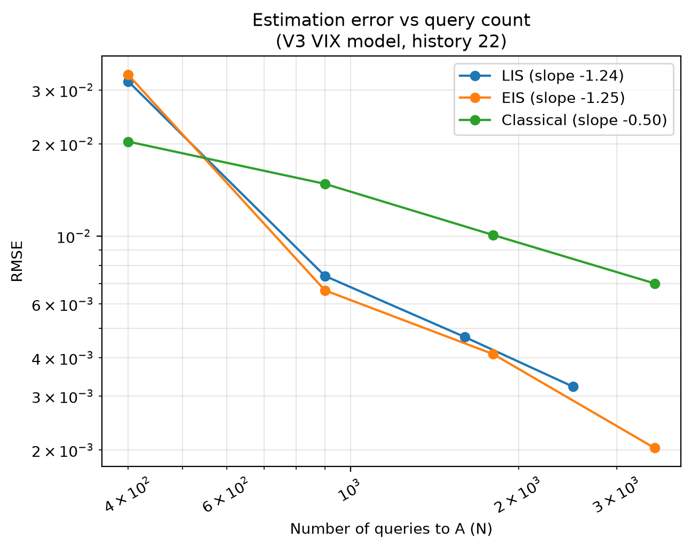

# Quantum Amplitude Estimation (QAE)

## What this does, in one paragraph

We want to know: **"Given the market's volatility over the last two days, what is the chance that volatility stays high (VIX ≥ 30) on at least 3 of the next 6 trading days?"** The usual way to estimate a probability like this is to simulate many possible futures and count how often the event happens (classical Monte Carlo). This code does the same job with a **quantum algorithm** and shows it reaches a more accurate answer for the same amount of work: about **2–3× less error** in our tests.

## Key ideas in plain language

| Term | What it means here |
| --- | --- |
| **VIX** | A market "fear index". Higher VIX means more volatile markets. We sort each day into low (< 20), moderate (20–30) or high (≥ 30). |
| **Risk event** | "VIX is high on at least 3 of the next 6 days." |
| **p** | The true probability of that event. Member 1's model gives it exactly, so we can check our answers against it. |
| **Classical Monte Carlo** | Simulate N random futures and count how many contain the event. The error shrinks slowly: 4× more samples only halve the error. |
| **Quantum amplitude estimation** | A quantum method that can, in principle, halve the error with only 2× more work, a "quadratic speed-up". |
| **MLAE** | Maximum Likelihood Amplitude Estimation: the practical version of amplitude estimation used here. It needs only short circuits plus some classical post-processing. |
| **Query (N)** | One use of the circuit that simulates the market. This is how we measure "amount of work", so classical and quantum are compared fairly. |
| **RMSE** | Root-mean-square error: the typical size of the estimation error. Lower is better. |

## How it works (4 steps)

1. **Simulate every possible future at once.** A quantum circuit (built by Member 2) holds all 729 possible 6-day VIX paths in superposition, each weighted by how likely it is.
2. **Mark the risky futures.** A small "counter" circuit counts how many of the 6 days have high VIX, and switches on a **flag qubit** when the count is 3 or more. If you measured the flag now, it would read 1 with probability exactly p.
3. **Amplify.** The **Grover operator** rotates the quantum state in a precise, predictable way, so that after m rotations the flag reads 1 with probability sin²((2m+1)θ), where sin²θ = p. Each rotation makes the flag far more sensitive to small changes in p.
4. **Estimate.** We run the circuit with several different numbers of rotations, count how often the flag reads 1, and find the value of p that best explains those counts. This is the "maximum likelihood" step.

## Results at a glance



At **N = 3,500 queries**, quantum error vs classical error for each starting history (the last two days' VIX levels):

| Last two days | Event probability p | Quantum error | Classical error | Quantum is… |
| --- | --- | --- | --- | --- |
| low, low (00) | 0.2% | 0.00022 | 0.00071 | 3.3× more accurate |
| low, moderate (01) | 4.2% | 0.00101 | 0.00341 | 3.4× more accurate |
| moderate, moderate (11) | 7.1% | 0.00190 | 0.00417 | 2.2× more accurate |
| moderate, high (12) | 64.0% | 0.00341 | 0.00798 | 2.3× more accurate |
| high, high (22) | 78.2% | 0.00203 | 0.00700 | 3.4× more accurate |

"Quantum" here is MLAE with the exponential schedule. Each value is the RMSE over 300 repeated runs, so each carries roughly ±8% sampling noise.

**What this shows:**
- Quantum estimation is **more accurate than classical at the same cost** for every history tested.
- Its error falls faster as you spend more queries: roughly like 1/N^0.9, against 1/N^0.5 for classical. That's close to the theoretical quantum speed-up.
- **The caveat:** with a very small budget (400 queries) the quantum method isn't reliably better, and for history 22 it was worse. It needs enough rotations to pin the answer down.

---

## Reproducing the experiment

Following these steps in order, with the same seed, gives **exactly** the numbers in this README.

### 1. What you need

- Python 3.12 or newer. No GPU and no quantum hardware; everything is a noiseless simulation on a laptop.
- About 1 GB of free memory.
- The files below, laid out like this. `qae.py` reads the model file and writes to `output/` using relative paths, so **always run from member3/ folder**.

```
<repo root>/
├── qae.py                                  # all QAE code (this part of the project)
├── qae_demo.ipynb                          # notebook that runs steps 3–7 below
├── member2/
│   └── sc4055_2.py                         # Member 2's circuit; must define build_A_structured
├── model/
│   └── nine_state_model_specification.json # Member 1's VIX model and exact probabilities
└── output/                                 # created automatically; results are saved here
```

### 2. Install

```bash
cd member3
python -m venv .venv
source .venv/bin/activate          # Windows: .venv\Scripts\activate
pip install "qiskit>=1.0" numpy scipy pandas matplotlib ipykernel
```

Qiskit Aer is **not** needed. The results below were reproduced with Python 3.13, qiskit 2.6.1, numpy 2.5.3, scipy 1.18.1, pandas 3.0.5 and matplotlib 3.11.2.

To use the notebook instead of a Python prompt, open `qae_demo.ipynb`, select the `.venv` kernel, and choose **Restart Kernel and Run All**. The notebook runs the same steps in the same order.

### 3. Start a session and set the seed

Start Python (or a fresh notebook kernel) **from the repository root**:

```python
from qae import *
np.random.seed(40552026)
LABELS = ["00", "01", "02", "10", "11", "12", "20", "21", "22"]
```

**History index:** `index = 3 × (day before yesterday) + (yesterday)`, with 0 = low, 1 = moderate, 2 = high. So `LABELS[8]` is "22" (high, high).

### 4. Check the circuit against the exact model (about 1–2 minutes)

```python
for i, lab in enumerate(LABELS):
    p = Statevector(build_A_v3_marked(i)).probabilities([19])[1]
    print(lab, f"{p:.8f}", f"{REF_V3[i]:.8f}", "OK" if abs(p - REF_V3[i]) < 1e-8 else "MISMATCH")
```

Expected: every line ends in `OK`.

```
00 0.00202700 0.00202700 OK
01 0.04185743 0.04185743 OK
02 0.29556214 0.29556214 OK
10 0.00959952 0.00959952 OK
11 0.07148326 0.07148326 OK
12 0.63992941 0.63992941 OK
20 0.11950470 0.11950470 OK
21 0.18732675 0.18732675 OK
22 0.78237398 0.78237398 OK
```

### 5. Check the Grover operator (about 1 minute)

```python
A = build_A_v3_marked(8)                 # history 22
Q = grover_op(A, 19)
theta = np.arcsin(np.sqrt(REF_V3[8]))
sv = Statevector(A)
for m in range(5):
    if m > 0:
        sv = sv.evolve(Q)
    print(m, round(sv.probabilities([19])[1], 4), round(np.sin((2*m + 1) * theta) ** 2, 4))
```

Expected: the simulated value (middle) equals the formula (right) on every line.

```
0 0.7824 0.7824
1 0.0131 0.0131
2 0.5702 0.5702
3 0.936 0.936
4 0.114 0.114
```

### 6. Count the circuit cost (a few seconds)

```python
print("A':", resources(A))     # (qubits, CX gates, depth)
print("Q :", resources(Q))
```

Expected: `A': (20, 440, 1389)` and `Q : (20, 2272, 3164)`. Gate counts can differ slightly on other Qiskit versions, because the compiler changes between releases.

### 7. Run the main experiment (about 15–40 minutes, 3–8 minutes per history)

```python
results_v3 = {}
for lab in ["00", "01", "11", "12", "22"]:
    i = LABELS.index(lab)
    A = build_A_v3_marked(i)
    Q = grover_op(A, 19)
    res = run_experiment(A, Q, REF_V3[i], flag_qubit=19)
    summarise(res, f"v3_{lab}")
    plot_results(res, f"Estimation error vs query count\n(V3 VIX model, history {lab})",
                 f"rmse_vs_N_v3_{lab}.png")
    results_v3[lab] = res
```

Expected last line of each summary:

```
v3_00: At N = 3500: EIS 0.00022 vs classical 0.00071 -> 3.3x lower
v3_01: At N = 3500: EIS 0.00101 vs classical 0.00341 -> 3.4x lower
v3_11: At N = 3500: EIS 0.00190 vs classical 0.00417 -> 2.2x lower
v3_12: At N = 3500: EIS 0.00341 vs classical 0.00798 -> 2.3x lower
v3_22: At N = 3500: EIS 0.00203 vs classical 0.00700 -> 3.4x lower
```

Files written to `output/`: `rmse_v3_<history>.csv` (columns `method, N, rmse`) and `rmse_vs_N_v3_<history>.png`, one pair per history.

### Experiment settings

| Setting | Value | Where it is set |
| --- | --- | --- |
| Random seed | 40552026 | `np.random.seed(...)` at the start of the session |
| Histories tested | 00, 01, 11, 12, 22 | the loop in step 7 |
| Repeats per data point | 300 | `trials` in `run_experiment` |
| Measurements per circuit | 100 | `shots` in `run_experiment` |
| Schedule sizes | K = 1 to 4 | `K_max` in `run_experiment` |
| Exponential schedule (EIS) | m = 0, 1, 2, 4, 8 → N = 400, 900, 1,800, 3,500 | `eis(K)` |
| Linear schedule (LIS) | m = 0, 1, 2, 3, 4 → N = 400, 900, 1,600, 2,500 | `lis(K)` |
| Likelihood search | 10,000-point grid for θ in [0, π/2] | `mlae` |
| Classical baseline | N samples, with N matched to the EIS budget | `rmse_classical` |
| Error measure | RMSE against Member 1's exact probability | `REF_V3` |

### Full expected results

RMSE for MLAE with the exponential schedule, and for classical Monte Carlo at the same N:

| History | Method | N = 400 | 900 | 1,800 | 3,500 |
| --- | --- | --- | --- | --- | --- |
| 00 | MLAE (EIS) | 0.00140 | 0.00077 | 0.00043 | 0.00022 |
| 00 | Classical | 0.00218 | 0.00152 | 0.00103 | 0.00071 |
| 01 | MLAE (EIS) | 0.00601 | 0.00329 | 0.00179 | 0.00101 |
| 01 | Classical | 0.01047 | 0.00697 | 0.00482 | 0.00341 |
| 11 | MLAE (EIS) | 0.00825 | 0.00629 | 0.00232 | 0.00190 |
| 11 | Classical | 0.01296 | 0.00830 | 0.00602 | 0.00417 |
| 12 | MLAE (EIS) | 0.02276 | 0.01314 | 0.00485 | 0.00341 |
| 12 | Classical | 0.02314 | 0.01567 | 0.01100 | 0.00798 |
| 22 | MLAE (EIS) | 0.03364 | 0.00664 | 0.00411 | 0.00203 |
| 22 | Classical | 0.02035 | 0.01481 | 0.01008 | 0.00700 |

RMSE for MLAE with the linear schedule:

| History | N = 400 | 900 | 1,600 | 2,500 |
| --- | --- | --- | --- | --- |
| 00 | 0.00143 | 0.00078 | 0.00047 | 0.00035 |
| 01 | 0.00629 | 0.00356 | 0.00319 | 0.00158 |
| 11 | 0.00879 | 0.00446 | 0.00316 | 0.00214 |
| 12 | 0.02514 | 0.01332 | 0.00541 | 0.00368 |
| 22 | 0.03203 | 0.00741 | 0.00468 | 0.00322 |

### Exact match or statistical match?

- **Exact match** needs the same seed, a fresh session, and the histories run in the order above. Steps 4–6 use no random numbers, so skipping them doesn't change the results.
- **Any other seed or order** gives numbers that agree within sampling noise: about ±8% on each RMSE, and more for history 11 (see "Check against the theoretical limit").

### Optional: the two-state testbed (a few seconds)

```python
np.random.seed(40552026)
A = build_A_markov_loss()
res_loss = run_experiment(A, grover_op(A, 3), p_true=0.034819255, flag_qubit=3, K_max=5)
summarise(res_loss, "loss")
plot_results(res_loss, "Estimation error vs query count\n(Markov model, 3-day loss ≤ −5%)", "rmse_vs_N_loss.png")
```

Expected last line: `At N = 6800: EIS 0.00083 vs classical 0.00231 -> 2.8x lower`.

### Troubleshooting

| Problem | Cause and fix |
| --- | --- |
| `FileNotFoundError: model/nine_state_model_specification.json` | Python wasn't started from the repository root. `cd` there first (in a notebook, check with `import os; os.getcwd()`). |
| `ModuleNotFoundError: No module named 'member2'` | Same cause, or `member2/sc4055_2.py` is missing. |
| `ImportError` mentioning `StatevectorSampler` | Qiskit is older than 1.0. Upgrade with `pip install -U qiskit`. |
| Numbers are close but not identical | The seed wasn't set, the kernel wasn't fresh, or the histories ran in a different order. |
| Wrong results after calling `mlae` directly on a new circuit | Call `clear_cache()` first. `run_experiment` does this automatically. |

---

## Files

| File | What's in it |
| --- | --- |
| `qae.py` | All the code: the event oracle, Grover operator, MLAE and experiments |
| `qae_demo.ipynb` | Step-by-step notebook: checks, experiments, plots |
| `member2/sc4055_2.py` | Member 2's circuit that simulates the VIX futures |
| `model/nine_state_model_specification.json` | Member 1's fitted VIX model and the exact probabilities |
| `output/` | Result tables (`.csv`) and plots (`.png`) |

## How we know it's correct

| Check | Result |
| --- | --- |
| Circuit's event probability vs Member 1's exact value, all 9 histories | Identical to 8 decimal places (step 4) |
| Grover rotation, history 22, m = 0–4 | Matches the formula sin²((2m+1)θ) (step 5) |
| Classical Monte Carlo error vs theory √(p(1−p)/N) | Matches for every history, within sampling noise |
| Fast sampling shortcut vs Qiskit's sampler | Same hit rates on the same circuits |
| A second, independently built circuit | Gave identical probabilities and identical estimates |

---

## Technical details

### Qubit layout (20 qubits)

| Qubits | Role |
| --- | --- |
| 0–3 | Memory register (Member 2's model state) |
| 4 + 2t, 5 + 2t | Day t's VIX category, t = 0…5. Qubit 5 + 2t = 1 means VIX ≥ 30 |
| 16–18 | Counter (3 bits) |
| 19 | Flag: 1 when the counter is ≥ 3 |

### Main functions

| Function | Description |
| --- | --- |
| `build_A_v3_marked(index)` | Member 2's circuit + the ≥3-of-6 counter oracle. The flag is on qubit 19 |
| `REF_V3` | Exact event probabilities for the 9 histories |
| `grover_op(A, flag_qubit)` | Grover operator Q = A′ S₀ A′† S_χ |
| `reflect_zero(n)` | The reflection S₀ used inside Q |
| `mlae(A, Q, ms, shots, flag_qubit)` | Returns (estimate p̂, queries used N) |
| `lis(K)`, `eis(K)` | Rotation schedules: m = 0, 1, …, K (linear) or m = 0, 1, 2, 4, …, 2^(K−1) (exponential) |
| `run_experiment(A, Q, p_true, ...)` | Error vs queries for quantum (both schedules) and classical |
| `summarise(...)`, `plot_results(...)` | Print/save the results table and plot |
| `resources(qc)` | Qubits, CX gates and depth after compiling to hardware gates |
| `count_hits(...)`, `count_hits_fast(...)` | Simulated measurements. The fast version computes each circuit's exact probability once, then samples from it (statistically identical for a noiseless simulator) |

### How the comparison is made fair

- **Query cost.** One run of a circuit with m Grover rotations uses the market circuit 2m + 1 times, so N = Σ shots × (2m + 1). Classical Monte Carlo is given the same N.
- **Classical baseline.** One classical sample is one simulated future, which contains the event with probability p. So N samples give a Binomial(N, p) count, and the code draws that count directly instead of simulating each path.
- **Same target.** Both methods are scored against Member 1's exact probability.

### Scaling (fitted log-log slopes, excluding N = 400)

| Method | Slope | Paper (Chen et al.) |
| --- | --- | --- |
| Classical | −0.50 to −0.56 | −0.5 |
| MLAE, linear schedule | −0.72 to −0.81 (−1.27 for history 12) | −0.75 |
| MLAE, exponential schedule | −0.87 to −1.00 | −0.98 |

Each slope is fitted through only three points that each carry about ±8% noise, so treat them as consistent with the paper, not as precise measurements. The −1.27 for history 12 comes from a poor estimate at N = 900 improving quickly; no method can truly scale faster than −1. The legend on each plot shows the slope through **all four** points, which is why the history 22 plot shows a steeper value.

### Check against the theoretical limit

No estimator using these circuits can beat the Cramér–Rao bound, √(p(1−p) / (shots × Σ(2m+1)²)). It needs no simulation:

```python
ms = eis(4)
for lab in ["00", "01", "11", "12", "22"]:
    p = REF_V3[LABELS.index(lab)]
    print(lab, round(np.sqrt(p * (1 - p) / (100 * sum((2*m + 1) ** 2 for m in ms))), 5))
```

| History | MLAE RMSE at N = 3,500 | Cramér–Rao bound | Reading |
| --- | --- | --- | --- |
| 00 | 0.00022 | 0.00022 | At the limit |
| 01 | 0.00101 | 0.00100 | At the limit |
| 11 | 0.00190 | 0.00128 | About 1.5× above |
| 12 | 0.00341 | 0.00239 | About 1.4× above |
| 22 | 0.00203 | 0.00205 | At the limit |

For histories 00, 01 and 22, MLAE is as accurate as these circuits allow. For 11 and 12, the likelihood has more than one peak with only 100 shots per circuit, and a few percent of runs pick a wrong one. In a separate 5,000-repeat check, history 11's error averaged 0.0022 (about 2.0× better than classical), so its 2.2× in the table is on the favourable side of the noise.

### Circuit cost (compiled to {CX, RZ, SX, X})

| Circuit | Qubits | CX gates | Depth |
| --- | --- | --- | --- |
| Market circuit + oracle (A′) | 20 | 440 | 1,389 |
| One Grover step (Q) | 20 | 2,272 | 3,164 |
| Deepest circuit used (8 Grover steps) | 20 | ≈ 18,600 | — |

### Earlier testbed: two-state model

Before V3, the pipeline was built on a simpler synthetic model (Normal / Stressed market, 3 days). For its "3-day loss ≤ −5%" event, quantum error at N = 6,800 was 2.8× lower than classical. Use `build_A_markov_loss()` with `flag_qubit=3`.

### Notes for developers

- Pass `flag_qubit` explicitly: 19 for V3, 3 for the two-state circuits.
- If you call `mlae` directly with a different circuit, call `clear_cache()` first. `run_experiment` does this automatically.
- Accuracy doesn't depend on how the market circuit is built (it depends only on p); circuit cost does.

## Limitations

- **Simulation only.** No real quantum hardware was used. The deepest circuit has about 18,600 two-qubit gates, far more than today's noisy hardware can run reliably.
- **Small budgets:** at N = 400 the quantum method was no better than classical for history 12 and worse for history 22.
- **Not always at the limit:** for histories 11 and 12 the estimator sits above the Cramér–Rao bound, because some runs pick a wrong likelihood peak.
- **It estimates the model's probability, not the market's.** Better estimation doesn't make Member 1's VIX model a better forecaster, and for this small model, an exact classical calculation takes milliseconds.

## Reference

J. Chen et al., "Quantum-Enhanced Inference of Conditional Future Probabilities with Reduced Memory Cost," arXiv:2610.10756 (2026).
